<!--
  Domain Name API (domainreseller): ICANN-accredited domain registrar founded by Atak Domain.
  Official registrar modules, SSL & reseller hosting modules and API libraries.
  Website: https://www.domainnameapi.com
  Every animation on this page is a hand-made SVG in ./assets. No external widgets, no trackers.
-->

<p align="center">
  <a href="https://github.com/domainreseller/domainreseller/blob/main/README-TR.md"></a>
  <a href="https://github.com/domainreseller"></a>
  <a href="https://github.com/domainreseller/domainreseller/blob/main/README-DE.md"></a>
  <a href="https://github.com/domainreseller/domainreseller/blob/main/README-SA.md"></a>
  <a href="https://github.com/domainreseller/domainreseller/blob/main/README-NL.md"></a>
  <a href="https://github.com/domainreseller/domainreseller/blob/main/README-AZ.md"></a>
  <a href="https://github.com/domainreseller/domainreseller/blob/main/README-CN.md"></a>
  <a href="https://github.com/domainreseller/domainreseller/blob/main/README-FR.md"></a>
  <a href="https://github.com/domainreseller/domainreseller/blob/main/README-IT.md"></a>
</p>

<a href="https://www.domainnameapi.com/az/domain-reseller"></a>

<h1 align="center">Domen Satıcılığı API &amp; Modulları</h1>

<p align="center">
  <b>Domain Name API</b> <a href="https://www.atakdomain.com">Atak Domain</a> tərəfindən yaradılmış ICANN akkreditasiyalı registrator və <b>domen satıcılığı (domain reseller)</b> proqramıdır. <a href="https://www.domainnameapi.com/az/domain-reseller">200+ ölkədən 40.000+ domen satıcısına</a> qoşulun, 830+ domen uzantısını öz brendiniz altında satın, qeydiyyat, transfer və yeniləmə əməliyyatlarını <a href="https://www.domainnameapi.com/az/domain-api-inteqrasiyasi">domen reseller API-miz</a> və ya aşağıdakı WHMCS, WiseCP, Blesta, HostBill, ClientExec, FOSSBilling və HostFact üçün hazır modullar vasitəsilə avtomatlaşdırın.
</p>

<p align="center">
  <a href="https://github.com/domainreseller/cli"></a>
</p>


##  dna CLI və AI agentləri üçün MCP server

Ən yeni alətimiz <b>dna</b> Domain Name API-nin bütün əməliyyatlarını terminalınızdan və AI agentlərinizdən icra edir. Domen axtarın, qeydiyyatdan keçirin, yeniləyin və transfer edin; DNS, DNSSEC, SSL və hostinqi idarə edin. Ödənişli əməliyyatdan əvvəl təhlükəsizlik qapısı həmişə təsdiqinizi gözləyir.

<a href="https://github.com/domainreseller/cli"></a>

<p align="center">
  <a href="https://github.com/domainreseller/cli/releases/latest"></a>
  <a href="https://github.com/domainreseller/cli#connect-your-ai-agent"></a>
  <a href="https://github.com/domainreseller/cli#readme"></a>
</p>

```bash
# Linux / macOS-da quraşdırma
curl -fsSL https://raw.githubusercontent.com/domainreseller/cli/main/scripts/install.sh | sh

# Claude Code-a qoşun (əvvəlcə OTE test mühitində başlayın)
claude mcp add dna -- dna mcp serve --env ote
```

```powershell
# Windows-da quraşdırma (PowerShell)
irm https://raw.githubusercontent.com/domainreseller/cli/main/scripts/install.ps1 | iex
```

### Claude və ChatGPT üçün hazır promptlar

Promptu kopyalayın, AI assistentinizə yapışdırın və işi ona həvalə edin. Hər prompt OTE test mühitində başlayır və ödənişli əməliyyatdan əvvəl dayanıb təsdiqinizi gözləyir.

**dna-nı Claude Code-da quraşdırın**

```text
Mənim üçün dna CLI-ni quraşdır (https://github.com/domainreseller/cli).
1. Onu əməliyyat sistemimə uyğun rəsmi quraşdırma skripti ilə quraşdır, sonra
   `dna version` və `dna doctor` əmrlərini işə sal.
2. Claude Code skill-ini `dna agent skill --install` ilə quraşdır və MCP serverini
   `claude mcp add dna -- dna mcp serve --env ote` ilə əlavə et.
3. API açarımı bu söhbətə yapışdırmağımı istəmə. `dna auth login --env ote` əmrini
   özüm işə salmağımı söylə, sonra bağlantını `dna --ote account get` ilə yoxla.
Yalnız OTE test mühitində işlə və mənim təsdiqim olmadan heç vaxt `--yes`
parametrindən istifadə etmə.
```

**dna-nı ChatGPT Codex-də quraşdırın**

```text
Mənim üçün dna CLI-ni quraşdır (https://github.com/domainreseller/cli).
1. Onu əməliyyat sistemimə uyğun rəsmi quraşdırma skripti ilə quraşdır, sonra
   `dna version` və `dna doctor` əmrlərini işə sal.
2. Onu Codex konfiqurasiyama (`~/.codex/config.toml`) `dna` adlı MCP server kimi əlavə
   et: əmr `dna`, arqumentlər `mcp serve --env ote`.
3. API açarımı bu söhbətə yapışdırmağımı istəmə. `dna auth login --env ote` əmrini
   özüm işə salmağımı söylə, sonra bağlantını `dna --ote account get` ilə yoxla.
Yalnız OTE test mühitində işlə və mənim təsdiqim olmadan heç vaxt `--yes`
parametrindən istifadə etmə.
```

**Terminalınız yoxdur? ChatGPT və ya Claude söhbətində soruşun**

```text
https://raw.githubusercontent.com/domainreseller/cli/main/llms.txt faylını və onun
keçid verdiyi dna sənədlərini oxu. Sonra OTE test mühitində bir domeni qeydiyyatdan
keçirmək üçün lazım olan dəqiq dna əmrlərini addım-addım ver: quraşdırma, giriş,
axtarış, `--dry-run` ilə önizləmə və qeydiyyat. Hər əmrin nə etdiyini izah et.
```

<details>
<summary><b>Gündəlik işlər üçün daha çox prompt</b></summary>
<br>

**Domen tapın və qeydiyyatdan keçirin**

```text
dna ilə brandname.com, brandname.net və brandname.io domenlərinin boş olub-olmadığını
yoxla. Nəticələri qiymətləri ilə birlikdə cədvəldə göstər, sonra boş olanlardan ən
ucuzunun qeydiyyatını `--dry-run` ilə önizlə. Mən hə deyənə qədər heç nəyi
qeydiyyatdan keçirmə.
```

**Yaxınlaşan yeniləmələr**

```text
dna ilə növbəti 60 gün ərzində müddəti bitəcək domenlərimi yeniləmə qiymətləri ilə
birlikdə, bitmə tarixinə görə sıralayaraq sadala. Heç nəyi yeniləmə.
```

**Domeni serverə yönləndirin**

```text
dna ilə example.com domenini 203.0.113.10 ünvanına yönləndir: `@` və `www` üçün A
qeydləri əlavə et, sonra mənə son DNS zonasını göstər. Hər hansı mövcud qeydi
dəyişməzdən və ya silməzdən əvvəl məndən soruş.
```

**Domeni hesabınıza transfer edin**

```text
dna ilə example.org domeninin hesabıma transfer edilə bilib-bilmədiyini yoxla, mənə
hələ nələrin lazım olduğunu de (auth kodu, kilidin açılması) və transferi `--dry-run`
ilə önizlə.
```

**SSL sertifikatı sifariş edin**

```text
dna ilə example.com üçün ən ucuz DV SSL sertifikatını tap, CSR yarat və sifarişi
önizlə. Almazdan əvvəl təsdiqimi gözlə.
```

</details>

##  Domen, SSL və hostinq satıcılığı proqramları

Bir Domain Name API hesabı, üç satıcılıq proqramı: domen adlarını, SSL sertifikatlarını və white-label hostinqi öz brendiniz altında satın.



<p align="center">
  <a href="https://www.domainnameapi.com/az/domain-reseller"></a>
  <a href="https://www.domainnameapi.com/az/ssl-reseller"></a>
  <a href="https://www.domainnameapi.com/az/reseller-hosting"></a>
</p>

##  Domen satıcılığı API-si necə işləyir


##  Domen reseller modulları

Billinq panelinizi Domain Name API-yə qoşan registrator modulları. Bu sayədə müştəriləriniz sizin saytınızda domen axtara, qeydiyyatdan keçirə, transfer edə və yeniləyə bilər.

> [!IMPORTANT]
> **Modulları həmişə aşağıdakı _son buraxılış (latest release)_ linklərindən yükləyin.** Buraxılış paketləri versiyalanıb, test olunub və canlı mühitdə istifadəyə hazırdır.

> [!WARNING]
> GitHub-ın yaşıl **Code → Download ZIP** düyməsindən **istifadə etməyin**; bu düymə test olunmamış inkişaf budağını yükləyir.

<table align="center">
<tr>
<td align="center">
<a href="https://github.com/domainreseller/whmcs-dna"></a><br>
<br>
<a href="https://github.com/domainreseller/whmcs-dna/releases/latest">📥 Yüklə</a> · <a href="https://github.com/domainreseller/whmcs-dna#readme">📝 Sənədlər</a>
</td>
<td align="center">
<a href="https://github.com/domainreseller/wisecp-dna-v5"></a><br>
<br>
<a href="https://github.com/domainreseller/wisecp-dna-v5/releases/latest">📥 Yüklə</a> · <a href="https://github.com/domainreseller/wisecp-dna-v5#readme">📝 Sənədlər</a>
</td>
<td align="center">
<a href="https://github.com/domainreseller/wisecp-dna"></a><br>
<br>
<a href="https://github.com/domainreseller/wisecp-dna/releases/latest">📥 Yüklə</a> · <a href="https://github.com/domainreseller/wisecp-dna#readme">📝 Sənədlər</a>
</td>
</tr>
<tr>
<td align="center">
<a href="https://github.com/domainreseller/blesta-dna"></a><br>
<br>
<a href="https://github.com/domainreseller/blesta-dna/releases/latest">📥 Yüklə</a> · <a href="https://github.com/domainreseller/blesta-dna#readme">📝 Sənədlər</a>
</td>
<td align="center">
<a href="https://github.com/domainreseller/hostbill-dna"></a><br>
<br>
<a href="https://github.com/domainreseller/hostbill-dna/releases/latest">📥 Yüklə</a> · <a href="https://github.com/domainreseller/hostbill-dna#readme">📝 Sənədlər</a>
</td>
<td align="center">
<a href="https://github.com/domainreseller/clientexec-dna"></a><br>
<br>
<a href="https://github.com/domainreseller/clientexec-dna/releases/latest">📥 Yüklə</a> · <a href="https://github.com/domainreseller/clientexec-dna#readme">📝 Sənədlər</a>
</td>
</tr>
<tr>
<td align="center">
<a href="https://github.com/domainreseller/fossbilling-dna"></a><br>
<br>
<a href="https://github.com/domainreseller/fossbilling-dna/releases/latest">📥 Yüklə</a> · <a href="https://github.com/domainreseller/fossbilling-dna#readme">📝 Sənədlər</a>
</td>
<td align="center">
<a href="https://github.com/domainreseller/hostfact-dna"></a><br>
<br>
<a href="https://github.com/domainreseller/hostfact-dna/releases/latest">📥 Yüklə</a> · <a href="https://github.com/domainreseller/hostfact-dna#readme">📝 Sənədlər</a>
</td>
<td align="center">
<a href="https://github.com/domainreseller/dna-extended"></a><br>
<br>
<a href="https://github.com/domainreseller/dna-extended/releases/latest">📥 Yüklə</a> · <a href="https://github.com/domainreseller/dna-extended#readme">📝 Sənədlər</a>
</td>
</tr>
</table>

##  Domen reseller API kitabxanaları

Öz inteqrasiyanızı qurursunuz? PHP, Node.js, Ruby, Python və Go kitabxanalarımızla domen satıcılığı API-sini birbaşa çağırın.

<table align="center">
<tr>
<td align="center">
<a href="https://github.com/domainreseller/php-dna"></a><br>
<br>
<a href="https://github.com/domainreseller/php-dna/releases/latest">📥 Yüklə</a> · <a href="https://github.com/domainreseller/php-dna#readme">📝 Sənədlər</a>
</td>
<td align="center">
<a href="https://github.com/domainreseller/nodejs-dna"></a><br>
<br>
<a href="https://github.com/domainreseller/nodejs-dna/releases/latest">📥 Yüklə</a> · <a href="https://github.com/domainreseller/nodejs-dna#readme">📝 Sənədlər</a>
</td>
<td align="center">
<a href="https://github.com/domainreseller/ruby-dna"></a><br>
<br>
<a href="https://rubygems.org/gems/domainnameapi">📥 Yüklə</a> · <a href="https://github.com/domainreseller/ruby-dna#readme">📝 Sənədlər</a>
</td>
</tr>
</table>

<table align="center">
<tr>
<td align="center">
<a href="https://github.com/domainreseller/python-dna"></a><br>
<br>
<a href="https://pypi.org/project/domainnameapi/">📥 Yüklə</a> · <a href="https://github.com/domainreseller/python-dna#readme">📝 Sənədlər</a>
</td>
<td align="center">
<a href="https://github.com/domainreseller/go-dna"></a><br>
<br>
<a href="https://github.com/domainreseller/go-dna/releases/latest">📥 Yüklə</a> · <a href="https://github.com/domainreseller/go-dna#readme">📝 Sənədlər</a>
</td>
</tr>
</table>

```bash
composer require domainreseller/php-dna   # PHP
npm install nodejs-dna                    # Node.js
gem install domainnameapi                 # Ruby
pip install domainnameapi                 # Python
go get github.com/domainreseller/go-dna   # Go
```

<details>
<summary><b>Sürətli başlanğıc: PHP</b></summary>

```php
require_once __DIR__.'/vendor/autoload.php';

$dna = new \DomainNameApi\DomainNameAPI_PHPLibrary($resellerId, $apiKey);

$dna->CheckAvailability(['hello', 'world123x0'], ['com', 'net'], 1, 'create');
```

</details>

<details>
<summary><b>Sürətli başlanğıc: Node.js</b></summary>

```js
const DomainNameApi = require('nodejs-dna');

const api = new DomainNameApi('xxxxxxxx-xxxx-xxxx-xxxx-xxxxxxxxxxxx', 'your-api-key');

const domains = await api.CheckAvailability(['hello', 'world'], ['com', 'net'], 1);
```

</details>

<details>
<summary><b>Sürətli başlanğıc: Ruby</b></summary>

```ruby
require 'domainnameapi'

dna = DomainNameApi::Client.new('xxxxxxxx-xxxx-xxxx-xxxx-xxxxxxxxxxxx', 'your-api-key')

dna.check_availability(['hello', 'world123x0'], ['com', 'net'], 1, 'create')
```

</details>

<details>
<summary><b>Sürətli başlanğıc: Python</b></summary>

```python
from domainnameapi import DomainNameAPI

dna = DomainNameAPI("xxxxxxxx-xxxx-xxxx-xxxx-xxxxxxxxxxxx", "your-api-key")

dna.check_availability(["hello", "world123x0"], ["com", "net"], 1, "create")
```

</details>

<details>
<summary><b>Sürətli başlanğıc: Go</b></summary>

```go
import dna "github.com/domainreseller/go-dna"

client := dna.New("xxxxxxxx-xxxx-xxxx-xxxx-xxxxxxxxxxxx", "your-api-key", false)

result := client.CheckAvailability([]string{"hello", "world123x0"}, []string{"com", "net"}, 1, "create")
```

</details>

##  SSL və reseller hostinq modulları

Domenlərdən daha çoxunu satın: [SSL Satıcılığı](https://www.domainnameapi.com/az/ssl-reseller) və [Reseller Hostinq](https://www.domainnameapi.com/az/reseller-hosting) proqramlarımız üçün modullar, SSL sertifikatları və cPanel / Plesk hostinq eyni hesabdan.

<table align="center">
<tr>
<td align="center">
<a href="https://github.com/domainreseller/whmcs-ssl-dna"></a><br>
<br>
<a href="https://github.com/domainreseller/whmcs-ssl-dna/releases/latest">📥 Yüklə</a> · <a href="https://github.com/domainreseller/whmcs-ssl-dna#readme">📝 Sənədlər</a>
</td>
<td align="center">
<a href="https://github.com/domainreseller/wisecp-ssl-dna"></a><br>
<br>
<a href="https://github.com/domainreseller/wisecp-ssl-dna/releases/latest">📥 Yüklə</a> · <a href="https://github.com/domainreseller/wisecp-ssl-dna#readme">📝 Sənədlər</a>
</td>
</tr>
<tr>
<td align="center">
<a href="https://github.com/domainreseller/reseller-hosting-whmcs"></a><br>
<br>
<a href="https://github.com/domainreseller/reseller-hosting-whmcs/releases/latest">📥 Yüklə</a> · <a href="https://github.com/domainreseller/reseller-hosting-whmcs#readme">📝 Sənədlər</a>
</td>
<td align="center">
<a href="https://github.com/domainreseller/reseller-hosting-wisecp"></a><br>
<br>
<a href="https://github.com/domainreseller/reseller-hosting-wisecp/releases/latest">📥 Yüklə</a> · <a href="https://github.com/domainreseller/reseller-hosting-wisecp#readme">📝 Sənədlər</a>
</td>
</tr>
</table>

##  API giriş məlumatları


Hər modul eyni iki dəyəri tələb edir:

| Modul sahəsi | Nə daxil etməli |
|---|---|
| **İstifadəçi adı (Username)** | Reseller ID, `xxxxxxxx-xxxx-xxxx-xxxx-xxxxxxxxxxxx` formatında UUID |
| **Şifrə (Password)** | API Key |

> [!TIP]
> **Reseller ID** və **API Key** məlumatlarınızı Domain Name API panelinizdə **API Tənzimləmələri (API Settings)** bölməsində tapa bilərsiniz.

> [!CAUTION]
> Bunlar **API giriş məlumatlarıdır**. Panelə giriş e-poçtunuz və şifrəniz burada **işləməyəcək**.

##  Domen satıcılığı: tez-tez verilən suallar

<details>
<summary><b>Domen satıcılığı (domen reseller) nədir?</b></summary>
<br>
Domen satıcısı domen adlarını öz brendi və öz qiymətləri ilə öz müştərilərinə satır, hər bir reyestrdə qeydiyyatı isə akkreditasiyalı registrator həyata keçirir. Domain Name API ilə bu registrator tərəfini əldə edirsiniz: 830+ uzantı, satıcı paneli və domen satıcılığı API-si, üstəlik artıq istifadə etdiyiniz billinq paneli üçün hazır modullar.
</details>

<details>
<summary><b>Domain Name API ilə necə domen satıcısı ola bilərəm?</b></summary>
<br>
<a href="https://www.domainnameapi.com/az/domain-reseller">Domen Satıcılığı səhifəsində</a> qeydiyyatdan keçin. Quraşdırma haqqı və minimum depozit tələbi yoxdur. Sonra panelinizdəki <b>API Tənzimləmələri (API Settings)</b> bölməsindən <b>Reseller ID</b> və <b>API Key</b> məlumatlarınızı götürün, yuxarıdakı siyahıdan billinq paneliniz üçün modulu quraşdırın və satışa başlayın.
</details>

<details>
<summary><b>AI agenti domenlərimi idarə edə bilərmi?</b></summary>
<br>
Bəli. <a href="https://github.com/domainreseller/cli">dna CLI</a> Domain Name API-nin hər əməliyyatını Claude Code, Cursor, Codex və digər MCP müştəriləri üçün MCP aləti kimi təqdim edir. Ödənişli və geri qaytarılmaz əməliyyatlar təsdiqinizi gözləyir, <code>--env ote</code> ilə isə agentlər əvvəlcə test mühitində işləyir.
</details>

<details>
<summary><b>Hansı faylı yükləməliyəm?</b></summary>
<br>
Həmişə modulun <b>son buraxılışına (latest release)</b> əlavə olunmuş paketi yükləyin (yuxarıdakı 📥 Yüklə linkləri). Yaşıl <b>Code → Download ZIP</b> düyməsi isə test olunmamış inkişaf budağını yükləyir.
</details>

<details>
<summary><b>WiseCP 3.x, yoxsa WiseCP 5?</b></summary>
<br>
WiseCP 5 (PHP 8.2+) üçün <a href="https://github.com/domainreseller/wisecp-dna-v5">wisecp-dna-v5</a>, WiseCP 3.x üçün isə <a href="https://github.com/domainreseller/wisecp-dna">wisecp-dna</a> modulundan istifadə edin.
</details>

<details>
<summary><b>Reseller ID və API Key məlumatlarımı harada tapa bilərəm?</b></summary>
<br>
Domain Name API panelinizdə <b>API Tənzimləmələri (API Settings)</b> bölməsində. Panelə giriş məlumatlarınız modullarda işləməyəcək.
</details>

<details>
<summary><b>Canlıya keçməzdən əvvəl test edə bilərəmmi?</b></summary>
<br>
Bəli. <a href="https://github.com/domainreseller/php-dna">PHP</a>, <a href="https://github.com/domainreseller/nodejs-dna">Node.js</a>, <a href="https://github.com/domainreseller/ruby-dna">Ruby</a>, <a href="https://github.com/domainreseller/python-dna">Python</a> və <a href="https://github.com/domainreseller/go-dna">Go</a> kitabxanaları test (OTE) mühitinə qoşula bilər; keçid üçün onların sənədlərinə baxın.
</details>

##  Əlaqə

<p align="center">
  <a href="https://www.domainnameapi.com/az"></a>
  <a href="https://www.domainnameapi.com/az/domain-reseller"></a>
  <a href="https://www.domainnameapi.com/az/domain-api-inteqrasiyasi"></a>
  <a href="https://www.domainnameapi.com/az/elaqe"></a>
</p>

<br>

<p align="right">
  <sub>Alətlər</sub><br>
  <a href="https://github.com/domainreseller/Trabis-turkey-tr-domain-registration-tr-domain-kayit"></a>
  <br>
  <sub>Bizi izləyin</sub><br>
  <a href="https://www.atakdomain.com"></a>
  <a href="https://www.linkedin.com/company/domain-name-reseller/"></a>
  <a href="https://x.com/dna_resellerapi"></a>
  <a href="https://www.youtube.com/DomainReseller"></a>
</p>
