<!--
  Domain Name API (domainreseller): ICANN-accredited domain registrar founded by Atak Domain.
  Official registrar modules, SSL & reseller hosting modules and API libraries.
  Website: https://www.domainnameapi.com
  Every animation on this page is a hand-made SVG in ./assets. No external widgets, no trackers.
-->

<p align="center">
  <a href="https://github.com/domainreseller/domainreseller/blob/main/README-TR.md"></a>
  <a href="https://github.com/domainreseller"></a>
  <a href="https://github.com/domainreseller/domainreseller/blob/main/README-DE.md"></a>
  <a href="https://github.com/domainreseller/domainreseller/blob/main/README-SA.md"></a>
  <a href="https://github.com/domainreseller/domainreseller/blob/main/README-NL.md"></a>
  <a href="https://github.com/domainreseller/domainreseller/blob/main/README-AZ.md"></a>
  <a href="https://github.com/domainreseller/domainreseller/blob/main/README-CN.md"></a>
  <a href="https://github.com/domainreseller/domainreseller/blob/main/README-FR.md"></a>
  <a href="https://github.com/domainreseller/domainreseller/blob/main/README-IT.md"></a>
</p>

<a href="https://www.domainnameapi.com/zh/yuming-zhuce"></a>

<h1 align="center">域名代理 API 与模块</h1>

<p align="center">
  <b>Domain Name API</b> 是由 <a href="https://www.atakdomain.com">Atak Domain</a> 创立的 ICANN 认证域名注册商及<b>域名代理（domain reseller）</b>计划。加入<a href="https://www.domainnameapi.com/zh/yuming-zhuce">来自 200+ 个国家的 40,000+ 名域名代理商</a>，以您自己的品牌销售 830+ 种域名后缀，并通过我们的<a href="https://www.domainnameapi.com/zh/domain-api-jicheng">域名代理 API</a>或下方适用于 WHMCS、WiseCP、Blesta、HostBill、ClientExec、FOSSBilling 和 HostFact 的现成模块，自动完成域名注册、转移和续费。
</p>


##  域名、SSL 与主机代理计划

一个 Domain Name API 账户，三大代理计划：以您自己的品牌销售域名、SSL 证书和白标主机。


<p align="center">
  <a href="https://www.domainnameapi.com/zh/yuming-zhuce"></a>
  <a href="https://www.domainnameapi.com/zh/ssl-dailishang"></a>
  <a href="https://www.domainnameapi.com/zh/zhuji-dailishang"></a>
</p>

##  域名代理 API 的工作原理



##  域名分销模块

注册商模块将您的计费系统与 Domain Name API 对接，让您的客户直接在您自己的网站上查询、注册、转移和续费域名。

> [!IMPORTANT]
> **请始终通过下方的 _最新版本_ 链接下载模块。** 发布包均带有版本号、经过测试，可直接用于生产环境。

> [!WARNING]
> **请勿**使用 GitHub 的绿色 **Code → Download ZIP** 按钮；它下载的是未经测试的开发分支。

<table align="center">
<tr>
<td align="center">
<a href="https://github.com/domainreseller/whmcs-dna"></a><br>
<br>
<a href="https://github.com/domainreseller/whmcs-dna/releases/latest">📥 下载</a> · <a href="https://github.com/domainreseller/whmcs-dna#readme">📝 文档</a>
</td>
<td align="center">
<a href="https://github.com/domainreseller/wisecp-dna-v5"></a><br>
<br>
<a href="https://github.com/domainreseller/wisecp-dna-v5/releases/latest">📥 下载</a> · <a href="https://github.com/domainreseller/wisecp-dna-v5#readme">📝 文档</a>
</td>
<td align="center">
<a href="https://github.com/domainreseller/wisecp-dna"></a><br>
<br>
<a href="https://github.com/domainreseller/wisecp-dna/releases/latest">📥 下载</a> · <a href="https://github.com/domainreseller/wisecp-dna#readme">📝 文档</a>
</td>
</tr>
<tr>
<td align="center">
<a href="https://github.com/domainreseller/blesta-dna"></a><br>
<br>
<a href="https://github.com/domainreseller/blesta-dna/releases/latest">📥 下载</a> · <a href="https://github.com/domainreseller/blesta-dna#readme">📝 文档</a>
</td>
<td align="center">
<a href="https://github.com/domainreseller/hostbill-dna"></a><br>
<br>
<a href="https://github.com/domainreseller/hostbill-dna/releases/latest">📥 下载</a> · <a href="https://github.com/domainreseller/hostbill-dna#readme">📝 文档</a>
</td>
<td align="center">
<a href="https://github.com/domainreseller/clientexec-dna"></a><br>
<br>
<a href="https://github.com/domainreseller/clientexec-dna/releases/latest">📥 下载</a> · <a href="https://github.com/domainreseller/clientexec-dna#readme">📝 文档</a>
</td>
</tr>
<tr>
<td align="center">
<a href="https://github.com/domainreseller/fossbilling-dna"></a><br>
<br>
<a href="https://github.com/domainreseller/fossbilling-dna/releases/latest">📥 下载</a> · <a href="https://github.com/domainreseller/fossbilling-dna#readme">📝 文档</a>
</td>
<td align="center">
<a href="https://github.com/domainreseller/hostfact-dna"></a><br>
<br>
<a href="https://github.com/domainreseller/hostfact-dna/releases/latest">📥 下载</a> · <a href="https://github.com/domainreseller/hostfact-dna#readme">📝 文档</a>
</td>
<td align="center">
<a href="https://github.com/domainreseller/dna-extended"></a><br>
<br>
<a href="https://github.com/domainreseller/dna-extended/releases/latest">📥 下载</a> · <a href="https://github.com/domainreseller/dna-extended#readme">📝 文档</a>
</td>
</tr>
</table>

##  域名代理 API 开发库

想自行开发集成？使用我们的 PHP、Node.js、Ruby、Python和Go 开发库直接调用域名代理 API。

<table align="center">
<tr>
<td align="center">
<a href="https://github.com/domainreseller/php-dna"></a><br>
<br>
<a href="https://github.com/domainreseller/php-dna/releases/latest">📥 下载</a> · <a href="https://github.com/domainreseller/php-dna#readme">📝 文档</a>
</td>
<td align="center">
<a href="https://github.com/domainreseller/nodejs-dna"></a><br>
<br>
<a href="https://github.com/domainreseller/nodejs-dna/releases/latest">📥 下载</a> · <a href="https://github.com/domainreseller/nodejs-dna#readme">📝 文档</a>
</td>
<td align="center">
<a href="https://github.com/domainreseller/ruby-dna"></a><br>
<br>
<a href="https://rubygems.org/gems/domainnameapi">📥 下载</a> · <a href="https://github.com/domainreseller/ruby-dna#readme">📝 文档</a>
</td>
</tr>
</table>

<table align="center">
<tr>
<td align="center">
<a href="https://github.com/domainreseller/python-dna"></a><br>
<br>
<a href="https://pypi.org/project/domainnameapi/">📥 下载</a> · <a href="https://github.com/domainreseller/python-dna#readme">📝 文档</a>
</td>
<td align="center">
<a href="https://github.com/domainreseller/go-dna"></a><br>
<br>
<a href="https://github.com/domainreseller/go-dna/releases/latest">📥 下载</a> · <a href="https://github.com/domainreseller/go-dna#readme">📝 文档</a>
</td>
</tr>
</table>

```bash
composer require domainreseller/php-dna   # PHP
npm install nodejs-dna                    # Node.js
gem install domainnameapi                 # Ruby
pip install domainnameapi                 # Python
go get github.com/domainreseller/go-dna   # Go
```

<details>
<summary><b>快速上手: PHP</b></summary>

```php
require_once __DIR__.'/vendor/autoload.php';

$dna = new \DomainNameApi\DomainNameAPI_PHPLibrary($resellerId, $apiKey);

$dna->CheckAvailability(['hello', 'world123x0'], ['com', 'net'], 1, 'create');
```

</details>

<details>
<summary><b>快速上手: Node.js</b></summary>

```js
const DomainNameApi = require('nodejs-dna');

const api = new DomainNameApi('xxxxxxxx-xxxx-xxxx-xxxx-xxxxxxxxxxxx', 'your-api-key');

const domains = await api.CheckAvailability(['hello', 'world'], ['com', 'net'], 1);
```

</details>

<details>
<summary><b>快速上手: Ruby</b></summary>

```ruby
require 'domainnameapi'

dna = DomainNameApi::Client.new('xxxxxxxx-xxxx-xxxx-xxxx-xxxxxxxxxxxx', 'your-api-key')

dna.check_availability(['hello', 'world123x0'], ['com', 'net'], 1, 'create')
```

</details>

<details>
<summary><b>快速上手: Python</b></summary>

```python
from domainnameapi import DomainNameAPI

dna = DomainNameAPI("xxxxxxxx-xxxx-xxxx-xxxx-xxxxxxxxxxxx", "your-api-key")

dna.check_availability(["hello", "world123x0"], ["com", "net"], 1, "create")
```

</details>

<details>
<summary><b>快速上手: Go</b></summary>

```go
import dna "github.com/domainreseller/go-dna"

client := dna.New("xxxxxxxx-xxxx-xxxx-xxxx-xxxxxxxxxxxx", "your-api-key", false)

result := client.CheckAvailability([]string{"hello", "world123x0"}, []string{"com", "net"}, 1, "create")
```

</details>

##  SSL 与主机代理模块

不止销售域名：适用于我们 [SSL 代理](https://www.domainnameapi.com/zh/ssl-dailishang) 和 [主机代理](https://www.domainnameapi.com/zh/zhuji-dailishang) 计划的模块，同一账户即可提供 SSL 证书及 cPanel / Plesk 主机。

<table align="center">
<tr>
<td align="center">
<a href="https://github.com/domainreseller/whmcs-ssl-dna"></a><br>
<br>
<a href="https://github.com/domainreseller/whmcs-ssl-dna/releases/latest">📥 下载</a> · <a href="https://github.com/domainreseller/whmcs-ssl-dna#readme">📝 文档</a>
</td>
<td align="center">
<a href="https://github.com/domainreseller/wisecp-ssl-dna"></a><br>
<br>
<a href="https://github.com/domainreseller/wisecp-ssl-dna/releases/latest">📥 下载</a> · <a href="https://github.com/domainreseller/wisecp-ssl-dna#readme">📝 文档</a>
</td>
</tr>
<tr>
<td align="center">
<a href="https://github.com/domainreseller/reseller-hosting-whmcs"></a><br>
<br>
<a href="https://github.com/domainreseller/reseller-hosting-whmcs/releases/latest">📥 下载</a> · <a href="https://github.com/domainreseller/reseller-hosting-whmcs#readme">📝 文档</a>
</td>
<td align="center">
<a href="https://github.com/domainreseller/reseller-hosting-wisecp"></a><br>
<br>
<a href="https://github.com/domainreseller/reseller-hosting-wisecp/releases/latest">📥 下载</a> · <a href="https://github.com/domainreseller/reseller-hosting-wisecp#readme">📝 文档</a>
</td>
</tr>
</table>

##  API 凭据



每个模块都需要填写相同的两项：

| 模块字段 | 填写内容 |
|---|---|
| **用户名 (Username)** | Reseller ID，即 UUID 格式，例如 `xxxxxxxx-xxxx-xxxx-xxxx-xxxxxxxxxxxx` |
| **密码 (Password)** | API Key |

> [!TIP]
> 您可以在 Domain Name API 面板的 **API 设置 (API Settings)** 中找到 **Reseller ID** 和 **API Key**。

> [!CAUTION]
> 这些是 **API 凭据**。您的面板登录邮箱和密码在这里**无法**使用。

##  域名代理常见问题

<details>
<summary><b>什么是域名代理商？</b></summary>
<br>
域名代理商（又称域名分销商）以自己的品牌和价格向自己的客户销售域名，而由经认证的注册商负责在各注册局完成注册。使用 Domain Name API，您获得的正是这一注册商端：830+ 种域名后缀、代理商面板和域名代理 API，以及适用于您现有计费系统的现成模块。
</details>

<details>
<summary><b>如何通过 Domain Name API 成为域名代理商？</b></summary>
<br>
在<a href="https://www.domainnameapi.com/zh/yuming-zhuce">域名代理页面</a>注册。无需开户费，也没有最低预存款要求。然后在面板的 <b>API 设置 (API Settings)</b> 中获取您的 <b>Reseller ID</b> 和 <b>API Key</b>，从上方列表中为您的计费系统安装对应模块，即可开始销售域名。
</details>

<details>
<summary><b>应该下载哪个文件？</b></summary>
<br>
始终下载模块<b>最新版本</b>所附带的安装包（即上方的 📥 下载链接）。绿色的 <b>Code → Download ZIP</b> 按钮下载的是未经测试的开发分支。
</details>

<details>
<summary><b>WiseCP 3.x 还是 WiseCP 5？</b></summary>
<br>
WiseCP 5（PHP 8.2+）请使用 <a href="https://github.com/domainreseller/wisecp-dna-v5">wisecp-dna-v5</a>，WiseCP 3.x 请使用 <a href="https://github.com/domainreseller/wisecp-dna">wisecp-dna</a>。
</details>

<details>
<summary><b>在哪里可以找到我的 Reseller ID 和 API Key？</b></summary>
<br>
在 Domain Name API 面板的 <b>API 设置 (API Settings)</b> 中。面板登录信息无法在模块中使用。
</details>

<details>
<summary><b>上线前可以先测试吗？</b></summary>
<br>
可以。<a href="https://github.com/domainreseller/php-dna">PHP</a>、<a href="https://github.com/domainreseller/nodejs-dna">Node.js</a>、<a href="https://github.com/domainreseller/ruby-dna">Ruby</a>、<a href="https://github.com/domainreseller/python-dna">Python</a>和<a href="https://github.com/domainreseller/go-dna">Go</a> 开发库均可连接测试（OTE）环境，切换方法请参阅各自的文档。
</details>

##  联系我们

<p align="center">
  <a href="https://www.domainnameapi.com/zh"></a>
  <a href="https://www.domainnameapi.com/zh/yuming-zhuce"></a>
  <a href="https://www.domainnameapi.com/zh/domain-api-jicheng"></a>
  <a href="https://www.domainnameapi.com/zh/lianxi-women"></a>
</p>

<br>

<p align="right">
  <sub>工具</sub><br>
  <a href="https://github.com/domainreseller/Trabis-turkey-tr-domain-registration-tr-domain-kayit"></a>
  <br>
  <sub>关注我们</sub><br>
  <a href="https://www.atakdomain.com"></a>
  <a href="https://www.linkedin.com/company/domain-name-reseller/"></a>
  <a href="https://x.com/dna_resellerapi"></a>
  <a href="https://www.youtube.com/DomainReseller"></a>
</p>
