<!--
  Domain Name API (domainreseller): ICANN-accredited domain registrar founded by Atak Domain.
  Official registrar modules, SSL & reseller hosting modules and API libraries.
  Website: https://www.domainnameapi.com
  Every animation on this page is a hand-made SVG in ./assets. No external widgets, no trackers.
-->

<p align="center">
  <a href="https://github.com/domainreseller/domainreseller/blob/main/README-TR.md"></a>
  <a href="https://github.com/domainreseller"></a>
  <a href="https://github.com/domainreseller/domainreseller/blob/main/README-DE.md"></a>
  <a href="https://github.com/domainreseller/domainreseller/blob/main/README-SA.md"></a>
  <a href="https://github.com/domainreseller/domainreseller/blob/main/README-NL.md"></a>
  <a href="https://github.com/domainreseller/domainreseller/blob/main/README-AZ.md"></a>
  <a href="https://github.com/domainreseller/domainreseller/blob/main/README-CN.md"></a>
  <a href="https://github.com/domainreseller/domainreseller/blob/main/README-FR.md"></a>
  <a href="https://github.com/domainreseller/domainreseller/blob/main/README-IT.md"></a>
</p>

<a href="https://www.domainnameapi.com/de/domain-reseller"></a>

<h1 align="center">Domain-Reseller-API &amp; Module</h1>

<p align="center">
  <b>Domain Name API</b> ist ein ICANN-akkreditierter Registrar und <b>Domain-Reseller-Programm</b>, gegründet von <a href="https://www.atakdomain.com">Atak Domain</a>. Schließen Sie sich <a href="https://www.domainnameapi.com/de/domain-reseller">über 40.000 Domain-Resellern in mehr als 200 Ländern</a> an, verkaufen Sie über 830 Domain-Endungen unter Ihrer eigenen Marke und automatisieren Sie Registrierung, Transfer und Verlängerung mit unserer <a href="https://www.domainnameapi.com/de/domain-api-integration">Domain-Reseller-API</a> oder den fertigen Modulen für WHMCS, WiseCP, Blesta, HostBill, ClientExec, FOSSBilling und HostFact weiter unten.
</p>

<p align="center">
  <a href="https://github.com/domainreseller/cli"></a>
</p>




##  dna CLI & MCP-Server für KI-Agenten

Unser neuestes Werkzeug: <b>dna</b> führt jede Operation der Domain Name API im Terminal und über KI-Agenten aus. Domains suchen, registrieren, verlängern und transferieren, DNS, DNSSEC, SSL und Hosting verwalten – mit einer Sicherheitsschranke, die vor jeder kostenpflichtigen Aktion auf Ihre Freigabe wartet.

<a href="https://github.com/domainreseller/cli"></a>

<p align="center">
  <a href="https://github.com/domainreseller/cli/releases/latest"></a>
  <a href="https://github.com/domainreseller/cli#connect-your-ai-agent"></a>
  <a href="https://github.com/domainreseller/cli#readme"></a>
</p>

```bash
# Installation unter Linux / macOS
curl -fsSL https://raw.githubusercontent.com/domainreseller/cli/main/scripts/install.sh | sh

# Mit Claude Code verbinden (zuerst in der OTE-Testumgebung)
claude mcp add dna -- dna mcp serve --env ote
```

```powershell
# Installation unter Windows (PowerShell)
irm https://raw.githubusercontent.com/domainreseller/cli/main/scripts/install.ps1 | iex
```

### Fertige Prompts für Claude und ChatGPT

Kopieren Sie einen Prompt, fügen Sie ihn in Ihren KI-Assistenten ein und lassen Sie ihn die Arbeit erledigen. Jeder Prompt beginnt in der OTE-Testumgebung und hält vor jeder kostenpflichtigen Aktion an, bis Sie sie freigeben.

**dna in Claude Code einrichten**

```text
Richte die dna CLI für mich ein (https://github.com/domainreseller/cli).
1. Installiere sie mit dem offiziellen Installationsskript für mein Betriebssystem und
   führe dann `dna version` und `dna doctor` aus.
2. Installiere den Skill für Claude Code mit `dna agent skill --install` und füge den
   MCP-Server mit `claude mcp add dna -- dna mcp serve --env ote` hinzu.
3. Fordere mich nicht auf, meinen API-Key in diesen Chat einzufügen. Sag mir, dass ich
   `dna auth login --env ote` selbst ausführen soll, und prüfe dann die Verbindung mit
   `dna --ote account get`.
Arbeite nur in der OTE-Testumgebung und verwende `--yes` niemals ohne meine Freigabe.
```

**dna in ChatGPT Codex einrichten**

```text
Richte die dna CLI für mich ein (https://github.com/domainreseller/cli).
1. Installiere sie mit dem offiziellen Installationsskript für mein Betriebssystem und
   führe dann `dna version` und `dna doctor` aus.
2. Trage sie in meiner Codex-Konfiguration (`~/.codex/config.toml`) als MCP-Server mit
   dem Namen `dna`, dem Befehl `dna` und den Argumenten `mcp serve --env ote` ein.
3. Fordere mich nicht auf, meinen API-Key in diesen Chat einzufügen. Sag mir, dass ich
   `dna auth login --env ote` selbst ausführen soll, und prüfe dann die Verbindung mit
   `dna --ote account get`.
Arbeite nur in der OTE-Testumgebung und verwende `--yes` niemals ohne meine Freigabe.
```

**Kein Terminal? Fragen Sie ChatGPT oder Claude im Chat**

```text
Lies https://raw.githubusercontent.com/domainreseller/cli/main/llms.txt und die dort
verlinkte dna-Dokumentation. Gib mir dann Schritt für Schritt die genauen dna-Befehle,
um eine Domain in der OTE-Testumgebung zu registrieren: installieren, anmelden,
suchen, mit `--dry-run` als Vorschau anzeigen und registrieren. Erkläre, was jeder
Befehl macht.
```

<details>
<summary><b>Weitere Prompts für die tägliche Arbeit</b></summary>
<br>

**Domain finden und registrieren**

```text
Prüfe mit dna, ob brandname.com, brandname.net und brandname.io verfügbar sind. Zeig
die Ergebnisse mit Preisen in einer Tabelle und zeig dann mit `--dry-run` eine
Vorschau der Registrierung für die günstigste verfügbare Domain. Registriere nichts,
bevor ich Ja sage.
```

**Anstehende Verlängerungen**

```text
Liste mit dna meine Domains auf, die in den nächsten 60 Tagen ablaufen, mit ihren
Verlängerungspreisen und sortiert nach Ablaufdatum. Verlängere nichts.
```

**Domain auf einen Server zeigen lassen**

```text
Lass example.com mit dna auf 203.0.113.10 zeigen: Lege A-Records für `@` und `www` an
und zeig mir anschließend die finale DNS-Zone. Frag mich, bevor du einen bestehenden
Eintrag änderst oder löschst.
```

**Domain in Ihr Konto transferieren**

```text
Prüfe mit dna, ob example.org in mein Konto transferiert werden kann, sag mir, was ich
noch brauche (Auth-Code, Entsperrung), und zeig mit `--dry-run` eine Vorschau des
Transfers.
```

**SSL-Zertifikat bestellen**

```text
Finde mit dna das günstigste DV-SSL-Zertifikat für example.com, erstelle einen CSR und
zeig mir eine Vorschau der Bestellung. Warte vor dem Kauf auf meine Freigabe.
```

</details>

##  Reseller-Programme für Domains, SSL & Hosting

Ein Konto bei Domain Name API, drei Reseller-Programme: Verkaufen Sie Domainnamen, SSL-Zertifikate und White-Label-Hosting unter Ihrer eigenen Marke.


<p align="center">
  <a href="https://www.domainnameapi.com/de/domain-reseller"></a>
  <a href="https://www.domainnameapi.com/de/ssl-reseller"></a>
  <a href="https://www.domainnameapi.com/de/reseller-hosting"></a>
</p>

##  So funktioniert die Domain-Reseller-API


##  Domain-Reseller-Module

Registrar-Module, die Ihr Abrechnungssystem mit Domain Name API verbinden, damit Ihre Kunden Domains direkt auf Ihrer Website suchen, registrieren, transferieren und verlängern können.

> [!IMPORTANT]
> **Laden Sie Module immer über die Links zum _neuesten Release_ weiter unten herunter.** Release-Pakete sind versioniert, getestet und produktionsreif.

> [!WARNING]
> Verwenden Sie **nicht** den grünen GitHub-Button **Code → Download ZIP**; damit laden Sie den ungetesteten Entwicklungszweig herunter.

<table align="center">
<tr>
<td align="center">
<a href="https://github.com/domainreseller/whmcs-dna"></a><br>
<br>
<a href="https://github.com/domainreseller/whmcs-dna/releases/latest">📥 Download</a> · <a href="https://github.com/domainreseller/whmcs-dna#readme">📝 Dokumentation</a>
</td>
<td align="center">
<a href="https://github.com/domainreseller/wisecp-dna-v5"></a><br>
<br>
<a href="https://github.com/domainreseller/wisecp-dna-v5/releases/latest">📥 Download</a> · <a href="https://github.com/domainreseller/wisecp-dna-v5#readme">📝 Dokumentation</a>
</td>
<td align="center">
<a href="https://github.com/domainreseller/wisecp-dna"></a><br>
<br>
<a href="https://github.com/domainreseller/wisecp-dna/releases/latest">📥 Download</a> · <a href="https://github.com/domainreseller/wisecp-dna#readme">📝 Dokumentation</a>
</td>
</tr>
<tr>
<td align="center">
<a href="https://github.com/domainreseller/blesta-dna"></a><br>
<br>
<a href="https://github.com/domainreseller/blesta-dna/releases/latest">📥 Download</a> · <a href="https://github.com/domainreseller/blesta-dna#readme">📝 Dokumentation</a>
</td>
<td align="center">
<a href="https://github.com/domainreseller/hostbill-dna"></a><br>
<br>
<a href="https://github.com/domainreseller/hostbill-dna/releases/latest">📥 Download</a> · <a href="https://github.com/domainreseller/hostbill-dna#readme">📝 Dokumentation</a>
</td>
<td align="center">
<a href="https://github.com/domainreseller/clientexec-dna"></a><br>
<br>
<a href="https://github.com/domainreseller/clientexec-dna/releases/latest">📥 Download</a> · <a href="https://github.com/domainreseller/clientexec-dna#readme">📝 Dokumentation</a>
</td>
</tr>
<tr>
<td align="center">
<a href="https://github.com/domainreseller/fossbilling-dna"></a><br>
<br>
<a href="https://github.com/domainreseller/fossbilling-dna/releases/latest">📥 Download</a> · <a href="https://github.com/domainreseller/fossbilling-dna#readme">📝 Dokumentation</a>
</td>
<td align="center">
<a href="https://github.com/domainreseller/hostfact-dna"></a><br>
<br>
<a href="https://github.com/domainreseller/hostfact-dna/releases/latest">📥 Download</a> · <a href="https://github.com/domainreseller/hostfact-dna#readme">📝 Dokumentation</a>
</td>
<td align="center">
<a href="https://github.com/domainreseller/dna-extended"></a><br>
<br>
<a href="https://github.com/domainreseller/dna-extended/releases/latest">📥 Download</a> · <a href="https://github.com/domainreseller/dna-extended#readme">📝 Dokumentation</a>
</td>
</tr>
</table>

##  Bibliotheken für die Domain-Reseller-API

Sie entwickeln Ihre eigene Integration? Rufen Sie die Domain-Reseller-API direkt mit unseren Bibliotheken für PHP, Node.js, Ruby, Python und Go auf.

<table align="center">
<tr>
<td align="center">
<a href="https://github.com/domainreseller/php-dna"></a><br>
<br>
<a href="https://github.com/domainreseller/php-dna/releases/latest">📥 Download</a> · <a href="https://github.com/domainreseller/php-dna#readme">📝 Dokumentation</a>
</td>
<td align="center">
<a href="https://github.com/domainreseller/nodejs-dna"></a><br>
<br>
<a href="https://github.com/domainreseller/nodejs-dna/releases/latest">📥 Download</a> · <a href="https://github.com/domainreseller/nodejs-dna#readme">📝 Dokumentation</a>
</td>
<td align="center">
<a href="https://github.com/domainreseller/ruby-dna"></a><br>
<br>
<a href="https://rubygems.org/gems/domainnameapi">📥 Download</a> · <a href="https://github.com/domainreseller/ruby-dna#readme">📝 Dokumentation</a>
</td>
</tr>
</table>

<table align="center">
<tr>
<td align="center">
<a href="https://github.com/domainreseller/python-dna"></a><br>
<br>
<a href="https://pypi.org/project/domainnameapi/">📥 Download</a> · <a href="https://github.com/domainreseller/python-dna#readme">📝 Dokumentation</a>
</td>
<td align="center">
<a href="https://github.com/domainreseller/go-dna"></a><br>
<br>
<a href="https://github.com/domainreseller/go-dna/releases/latest">📥 Download</a> · <a href="https://github.com/domainreseller/go-dna#readme">📝 Dokumentation</a>
</td>
</tr>
</table>

```bash
composer require domainreseller/php-dna   # PHP
npm install nodejs-dna                    # Node.js
gem install domainnameapi                 # Ruby
pip install domainnameapi                 # Python
go get github.com/domainreseller/go-dna   # Go
```

<details>
<summary><b>Schnellstart: PHP</b></summary>

```php
require_once __DIR__.'/vendor/autoload.php';

$dna = new \DomainNameApi\DomainNameAPI_PHPLibrary($resellerId, $apiKey);

$dna->CheckAvailability(['hello', 'world123x0'], ['com', 'net'], 1, 'create');
```

</details>

<details>
<summary><b>Schnellstart: Node.js</b></summary>

```js
const DomainNameApi = require('nodejs-dna');

const api = new DomainNameApi('xxxxxxxx-xxxx-xxxx-xxxx-xxxxxxxxxxxx', 'your-api-key');

const domains = await api.CheckAvailability(['hello', 'world'], ['com', 'net'], 1);
```

</details>

<details>
<summary><b>Schnellstart: Ruby</b></summary>

```ruby
require 'domainnameapi'

dna = DomainNameApi::Client.new('xxxxxxxx-xxxx-xxxx-xxxx-xxxxxxxxxxxx', 'your-api-key')

dna.check_availability(['hello', 'world123x0'], ['com', 'net'], 1, 'create')
```

</details>

<details>
<summary><b>Schnellstart: Python</b></summary>

```python
from domainnameapi import DomainNameAPI

dna = DomainNameAPI("xxxxxxxx-xxxx-xxxx-xxxx-xxxxxxxxxxxx", "your-api-key")

dna.check_availability(["hello", "world123x0"], ["com", "net"], 1, "create")
```

</details>

<details>
<summary><b>Schnellstart: Go</b></summary>

```go
import dna "github.com/domainreseller/go-dna"

client := dna.New("xxxxxxxx-xxxx-xxxx-xxxx-xxxxxxxxxxxx", "your-api-key", false)

result := client.CheckAvailability([]string{"hello", "world123x0"}, []string{"com", "net"}, 1, "create")
```

</details>

##  Module für SSL & Reseller-Hosting

Verkaufen Sie mehr als Domains: Module für unsere Programme [SSL-Reseller](https://www.domainnameapi.com/de/ssl-reseller) und [Reseller-Hosting](https://www.domainnameapi.com/de/reseller-hosting), mit SSL-Zertifikaten und Hosting mit cPanel oder Plesk aus demselben Konto.

<table align="center">
<tr>
<td align="center">
<a href="https://github.com/domainreseller/whmcs-ssl-dna"></a><br>
<br>
<a href="https://github.com/domainreseller/whmcs-ssl-dna/releases/latest">📥 Download</a> · <a href="https://github.com/domainreseller/whmcs-ssl-dna#readme">📝 Dokumentation</a>
</td>
<td align="center">
<a href="https://github.com/domainreseller/wisecp-ssl-dna"></a><br>
<br>
<a href="https://github.com/domainreseller/wisecp-ssl-dna/releases/latest">📥 Download</a> · <a href="https://github.com/domainreseller/wisecp-ssl-dna#readme">📝 Dokumentation</a>
</td>
</tr>
<tr>
<td align="center">
<a href="https://github.com/domainreseller/reseller-hosting-whmcs"></a><br>
<br>
<a href="https://github.com/domainreseller/reseller-hosting-whmcs/releases/latest">📥 Download</a> · <a href="https://github.com/domainreseller/reseller-hosting-whmcs#readme">📝 Dokumentation</a>
</td>
<td align="center">
<a href="https://github.com/domainreseller/reseller-hosting-wisecp"></a><br>
<br>
<a href="https://github.com/domainreseller/reseller-hosting-wisecp/releases/latest">📥 Download</a> · <a href="https://github.com/domainreseller/reseller-hosting-wisecp#readme">📝 Dokumentation</a>
</td>
</tr>
</table>

##  API-Zugangsdaten


Jedes Modul fragt dieselben zwei Werte ab:

| Modulfeld | Was Sie eintragen |
|---|---|
| **Benutzername (Username)** | Reseller ID, eine UUID wie `xxxxxxxx-xxxx-xxxx-xxxx-xxxxxxxxxxxx` |
| **Passwort (Password)** | API Key |

> [!TIP]
> Ihre **Reseller ID** und Ihren **API Key** finden Sie in Ihrem Panel bei Domain Name API unter **API-Einstellungen (API Settings)**.

> [!CAUTION]
> Dies sind **API-Zugangsdaten**. Die E-Mail-Adresse und das Passwort für Ihren Panel-Login funktionieren hier **nicht**.

##  Domain-Reseller-FAQ

<details>
<summary><b>Was ist ein Domain-Reseller?</b></summary>
<br>
Ein Domain-Reseller verkauft Domainnamen unter eigener Marke und zu eigenen Preisen an seine Kunden weiter, während ein akkreditierter Registrar die Registrierung bei der jeweiligen Registry übernimmt. Mit Domain Name API haben Sie diesen Registrar an Ihrer Seite: über 830 Domain-Endungen, ein Reseller-Panel und die Domain-Reseller-API sowie fertige Module für das Abrechnungssystem, das Sie bereits nutzen.
</details>

<details>
<summary><b>Wie kann ich bei Domain Name API Domain-Reseller werden?</b></summary>
<br>
Registrieren Sie sich auf der <a href="https://www.domainnameapi.com/de/domain-reseller">Domain-Reseller-Seite</a>. Es gibt keine Einrichtungsgebühr und keine Mindesteinzahlung. Rufen Sie dann in Ihrem Panel unter <b>API-Einstellungen (API Settings)</b> Ihre <b>Reseller ID</b> und Ihren <b>API Key</b> ab, installieren Sie das Modul für Ihr Abrechnungssystem aus der Liste oben, und schon können Sie Domains weiterverkaufen.
</details>

<details>
<summary><b>Kann ein KI-Agent meine Domains verwalten?</b></summary>
<br>
Ja. Die <a href="https://github.com/domainreseller/cli">dna CLI</a> stellt jede Operation der Domain Name API als MCP-Tool für Claude Code, Cursor, Codex und andere MCP-Clients bereit. Kostenpflichtige und destruktive Aufrufe warten auf Ihre Freigabe, und mit <code>--env ote</code> üben Agenten zuerst in der Testumgebung.
</details>

<details>
<summary><b>Welche Datei soll ich herunterladen?</b></summary>
<br>
Immer das Paket, das dem <b>neuesten Release</b> des Moduls angehängt ist (die 📥 Download-Links oben). Der grüne Button <b>Code → Download ZIP</b> liefert Ihnen den ungetesteten Entwicklungszweig.
</details>

<details>
<summary><b>WiseCP 3.x oder WiseCP 5?</b></summary>
<br>
Verwenden Sie <a href="https://github.com/domainreseller/wisecp-dna-v5">wisecp-dna-v5</a> für WiseCP 5 (PHP 8.2+) und <a href="https://github.com/domainreseller/wisecp-dna">wisecp-dna</a> für WiseCP 3.x.
</details>

<details>
<summary><b>Wo finde ich meine Reseller ID und meinen API Key?</b></summary>
<br>
In Ihrem Panel bei Domain Name API unter <b>API-Einstellungen (API Settings)</b>. Ihre Login-Daten für das Panel funktionieren in den Modulen nicht.
</details>

<details>
<summary><b>Kann ich testen, bevor ich live gehe?</b></summary>
<br>
Ja. Die Bibliotheken für <a href="https://github.com/domainreseller/php-dna">PHP</a>, <a href="https://github.com/domainreseller/nodejs-dna">Node.js</a>, <a href="https://github.com/domainreseller/ruby-dna">Ruby</a>, <a href="https://github.com/domainreseller/python-dna">Python</a> und <a href="https://github.com/domainreseller/go-dna">Go</a> können sich mit der Testumgebung (OTE) verbinden; wie Sie umschalten, steht in der jeweiligen Dokumentation.
</details>

##  Kontakt

<p align="center">
  <a href="https://www.domainnameapi.com/de"></a>
  <a href="https://www.domainnameapi.com/de/domain-reseller"></a>
  <a href="https://www.domainnameapi.com/de/domain-api-integration"></a>
  <a href="https://www.domainnameapi.com/de/kontakt"></a>
</p>

<br>

<p align="right">
  <sub>Tools</sub><br>
  <a href="https://github.com/domainreseller/Trabis-turkey-tr-domain-registration-tr-domain-kayit"></a>
  <br>
  <sub>Folgen Sie uns</sub><br>
  <a href="https://www.atakdomain.com"></a>
  <a href="https://www.linkedin.com/company/domain-name-reseller/"></a>
  <a href="https://x.com/dna_resellerapi"></a>
  <a href="https://www.youtube.com/DomainReseller"></a>
</p>
