<!--
  Domain Name API (domainreseller): ICANN-accredited domain registrar founded by Atak Domain.
  Official registrar modules, SSL & reseller hosting modules and API libraries.
  Website: https://www.domainnameapi.com
  Every animation on this page is a hand-made SVG in ./assets. No external widgets, no trackers.
-->

<p align="center">
  <a href="https://github.com/domainreseller/domainreseller/blob/main/README-TR.md"></a>
  <a href="https://github.com/domainreseller"></a>
  <a href="https://github.com/domainreseller/domainreseller/blob/main/README-DE.md"></a>
  <a href="https://github.com/domainreseller/domainreseller/blob/main/README-SA.md"></a>
  <a href="https://github.com/domainreseller/domainreseller/blob/main/README-NL.md"></a>
  <a href="https://github.com/domainreseller/domainreseller/blob/main/README-AZ.md"></a>
  <a href="https://github.com/domainreseller/domainreseller/blob/main/README-CN.md"></a>
  <a href="https://github.com/domainreseller/domainreseller/blob/main/README-FR.md"></a>
  <a href="https://github.com/domainreseller/domainreseller/blob/main/README-IT.md"></a>
</p>

<a href="https://www.domainnameapi.com/fr/revendeur-de-domaine"></a>

<h1 align="center">Revendeur de noms de domaine : API &amp; modules</h1>

<p align="center">
  <b>Domain Name API</b> est un registrar accrédité par l'ICANN et un programme de <b>revendeur de noms de domaine</b> fondé par <a href="https://www.atakdomain.com">Atak Domain</a>. Rejoignez <a href="https://www.domainnameapi.com/fr/revendeur-de-domaine">plus de 40 000 revendeurs de domaines dans plus de 200 pays</a>, vendez plus de 830 extensions de domaine sous votre propre marque et automatisez l'enregistrement, le transfert et le renouvellement grâce à notre <a href="https://www.domainnameapi.com/fr/domain-api-integration">API revendeur de domaines</a> ou aux modules prêts à l'emploi pour WHMCS, WiseCP, Blesta, HostBill, ClientExec, FOSSBilling et HostFact ci-dessous.
</p>


##  Programmes revendeur de domaines, SSL et hébergement

Un seul compte Domain Name API, trois programmes revendeur : vendez sous votre propre marque des noms de domaine, des certificats SSL et de l'hébergement en marque blanche.


<p align="center">
  <a href="https://www.domainnameapi.com/fr/revendeur-de-domaine"></a>
  <a href="https://www.domainnameapi.com/fr/ssl-reseller"></a>
  <a href="https://www.domainnameapi.com/fr/hebergement-revendeur"></a>
</p>

##  Comment fonctionne l'API revendeur de domaines


##  Modules pour revendeurs de noms de domaine

Des modules registrar qui relient votre logiciel de facturation à Domain Name API, pour que vos clients puissent rechercher, enregistrer, transférer et renouveler des domaines sur votre propre site.

> [!IMPORTANT]
> **Téléchargez toujours les modules depuis la _dernière version publiée_, via les liens ci-dessous.** Ces paquets sont versionnés, testés et prêts pour la production.

> [!WARNING]
> N'utilisez **pas** le bouton vert **Code → Download ZIP** de GitHub : il télécharge la branche de développement, non testée.

<table align="center">
<tr>
<td align="center">
<a href="https://github.com/domainreseller/whmcs-dna"></a><br>
<br>
<a href="https://github.com/domainreseller/whmcs-dna/releases/latest">📥 Télécharger</a> · <a href="https://github.com/domainreseller/whmcs-dna#readme">📝 Documentation</a>
</td>
<td align="center">
<a href="https://github.com/domainreseller/wisecp-dna-v5"></a><br>
<br>
<a href="https://github.com/domainreseller/wisecp-dna-v5/releases/latest">📥 Télécharger</a> · <a href="https://github.com/domainreseller/wisecp-dna-v5#readme">📝 Documentation</a>
</td>
<td align="center">
<a href="https://github.com/domainreseller/wisecp-dna"></a><br>
<br>
<a href="https://github.com/domainreseller/wisecp-dna/releases/latest">📥 Télécharger</a> · <a href="https://github.com/domainreseller/wisecp-dna#readme">📝 Documentation</a>
</td>
</tr>
<tr>
<td align="center">
<a href="https://github.com/domainreseller/blesta-dna"></a><br>
<br>
<a href="https://github.com/domainreseller/blesta-dna/releases/latest">📥 Télécharger</a> · <a href="https://github.com/domainreseller/blesta-dna#readme">📝 Documentation</a>
</td>
<td align="center">
<a href="https://github.com/domainreseller/hostbill-dna"></a><br>
<br>
<a href="https://github.com/domainreseller/hostbill-dna/releases/latest">📥 Télécharger</a> · <a href="https://github.com/domainreseller/hostbill-dna#readme">📝 Documentation</a>
</td>
<td align="center">
<a href="https://github.com/domainreseller/clientexec-dna"></a><br>
<br>
<a href="https://github.com/domainreseller/clientexec-dna/releases/latest">📥 Télécharger</a> · <a href="https://github.com/domainreseller/clientexec-dna#readme">📝 Documentation</a>
</td>
</tr>
<tr>
<td align="center">
<a href="https://github.com/domainreseller/fossbilling-dna"></a><br>
<br>
<a href="https://github.com/domainreseller/fossbilling-dna/releases/latest">📥 Télécharger</a> · <a href="https://github.com/domainreseller/fossbilling-dna#readme">📝 Documentation</a>
</td>
<td align="center">
<a href="https://github.com/domainreseller/hostfact-dna"></a><br>
<br>
<a href="https://github.com/domainreseller/hostfact-dna/releases/latest">📥 Télécharger</a> · <a href="https://github.com/domainreseller/hostfact-dna#readme">📝 Documentation</a>
</td>
<td align="center">
<a href="https://github.com/domainreseller/dna-extended"></a><br>
<br>
<a href="https://github.com/domainreseller/dna-extended/releases/latest">📥 Télécharger</a> · <a href="https://github.com/domainreseller/dna-extended#readme">📝 Documentation</a>
</td>
</tr>
</table>

##  Bibliothèques pour l'API revendeur de domaines

Vous développez votre propre intégration ? Appelez directement l'API revendeur de domaines avec nos bibliothèques PHP, Node.js, Ruby, Python et Go.

<table align="center">
<tr>
<td align="center">
<a href="https://github.com/domainreseller/php-dna"></a><br>
<br>
<a href="https://github.com/domainreseller/php-dna/releases/latest">📥 Télécharger</a> · <a href="https://github.com/domainreseller/php-dna#readme">📝 Documentation</a>
</td>
<td align="center">
<a href="https://github.com/domainreseller/nodejs-dna"></a><br>
<br>
<a href="https://github.com/domainreseller/nodejs-dna/releases/latest">📥 Télécharger</a> · <a href="https://github.com/domainreseller/nodejs-dna#readme">📝 Documentation</a>
</td>
<td align="center">
<a href="https://github.com/domainreseller/ruby-dna"></a><br>
<br>
<a href="https://rubygems.org/gems/domainnameapi">📥 Télécharger</a> · <a href="https://github.com/domainreseller/ruby-dna#readme">📝 Documentation</a>
</td>
</tr>
</table>

<table align="center">
<tr>
<td align="center">
<a href="https://github.com/domainreseller/python-dna"></a><br>
<br>
<a href="https://pypi.org/project/domainnameapi/">📥 Télécharger</a> · <a href="https://github.com/domainreseller/python-dna#readme">📝 Documentation</a>
</td>
<td align="center">
<a href="https://github.com/domainreseller/go-dna"></a><br>
<br>
<a href="https://github.com/domainreseller/go-dna/releases/latest">📥 Télécharger</a> · <a href="https://github.com/domainreseller/go-dna#readme">📝 Documentation</a>
</td>
</tr>
</table>

```bash
composer require domainreseller/php-dna   # PHP
npm install nodejs-dna                    # Node.js
gem install domainnameapi                 # Ruby
pip install domainnameapi                 # Python
go get github.com/domainreseller/go-dna   # Go
```

<details>
<summary><b>Démarrage rapide : PHP</b></summary>

```php
require_once __DIR__.'/vendor/autoload.php';

$dna = new \DomainNameApi\DomainNameAPI_PHPLibrary($resellerId, $apiKey);

$dna->CheckAvailability(['hello', 'world123x0'], ['com', 'net'], 1, 'create');
```

</details>

<details>
<summary><b>Démarrage rapide : Node.js</b></summary>

```js
const DomainNameApi = require('nodejs-dna');

const api = new DomainNameApi('xxxxxxxx-xxxx-xxxx-xxxx-xxxxxxxxxxxx', 'your-api-key');

const domains = await api.CheckAvailability(['hello', 'world'], ['com', 'net'], 1);
```

</details>

<details>
<summary><b>Démarrage rapide : Ruby</b></summary>

```ruby
require 'domainnameapi'

dna = DomainNameApi::Client.new('xxxxxxxx-xxxx-xxxx-xxxx-xxxxxxxxxxxx', 'your-api-key')

dna.check_availability(['hello', 'world123x0'], ['com', 'net'], 1, 'create')
```

</details>

<details>
<summary><b>Démarrage rapide : Python</b></summary>

```python
from domainnameapi import DomainNameAPI

dna = DomainNameAPI("xxxxxxxx-xxxx-xxxx-xxxx-xxxxxxxxxxxx", "your-api-key")

dna.check_availability(["hello", "world123x0"], ["com", "net"], 1, "create")
```

</details>

<details>
<summary><b>Démarrage rapide : Go</b></summary>

```go
import dna "github.com/domainreseller/go-dna"

client := dna.New("xxxxxxxx-xxxx-xxxx-xxxx-xxxxxxxxxxxx", "your-api-key", false)

result := client.CheckAvailability([]string{"hello", "world123x0"}, []string{"com", "net"}, 1, "create")
```

</details>

##  Modules SSL et hébergement revendeur

Vendez bien plus que des domaines : des modules pour nos programmes [Revendeur SSL](https://www.domainnameapi.com/fr/ssl-reseller) et [Hébergement revendeur](https://www.domainnameapi.com/fr/hebergement-revendeur), avec certificats SSL et hébergement cPanel / Plesk depuis le même compte.

<table align="center">
<tr>
<td align="center">
<a href="https://github.com/domainreseller/whmcs-ssl-dna"></a><br>
<br>
<a href="https://github.com/domainreseller/whmcs-ssl-dna/releases/latest">📥 Télécharger</a> · <a href="https://github.com/domainreseller/whmcs-ssl-dna#readme">📝 Documentation</a>
</td>
<td align="center">
<a href="https://github.com/domainreseller/wisecp-ssl-dna"></a><br>
<br>
<a href="https://github.com/domainreseller/wisecp-ssl-dna/releases/latest">📥 Télécharger</a> · <a href="https://github.com/domainreseller/wisecp-ssl-dna#readme">📝 Documentation</a>
</td>
</tr>
<tr>
<td align="center">
<a href="https://github.com/domainreseller/reseller-hosting-whmcs"></a><br>
<br>
<a href="https://github.com/domainreseller/reseller-hosting-whmcs/releases/latest">📥 Télécharger</a> · <a href="https://github.com/domainreseller/reseller-hosting-whmcs#readme">📝 Documentation</a>
</td>
<td align="center">
<a href="https://github.com/domainreseller/reseller-hosting-wisecp"></a><br>
<br>
<a href="https://github.com/domainreseller/reseller-hosting-wisecp/releases/latest">📥 Télécharger</a> · <a href="https://github.com/domainreseller/reseller-hosting-wisecp#readme">📝 Documentation</a>
</td>
</tr>
</table>

##  Identifiants API


Chaque module demande les deux mêmes valeurs :

| Champ du module | Valeur à saisir |
|---|---|
| **Nom d'utilisateur (Username)** | Reseller ID, un UUID au format `xxxxxxxx-xxxx-xxxx-xxxx-xxxxxxxxxxxx` |
| **Mot de passe (Password)** | API Key |

> [!TIP]
> Votre **Reseller ID** et votre **API Key** se trouvent dans votre panneau Domain Name API, sous **Paramètres API (API Settings)**.

> [!CAUTION]
> Il s'agit d'**identifiants API**. L'e-mail et le mot de passe de connexion à votre panneau ne fonctionnent **pas** ici.

##  FAQ revendeur de noms de domaine

<details>
<summary><b>Qu'est-ce qu'un revendeur de noms de domaine ?</b></summary>
<br>
Un revendeur de noms de domaine (domain reseller) vend des noms de domaine à ses propres clients, sous sa propre marque et à ses propres prix, tandis qu'un registrar accrédité gère l'enregistrement auprès de chaque registre. Avec Domain Name API, vous disposez de ce côté registrar : plus de 830 extensions, un panneau revendeur et l'API revendeur de domaines, ainsi que des modules prêts à l'emploi pour le logiciel de facturation que vous utilisez déjà.
</details>

<details>
<summary><b>Comment devenir revendeur de noms de domaine avec Domain Name API ?</b></summary>
<br>
Inscrivez-vous sur la <a href="https://www.domainnameapi.com/fr/revendeur-de-domaine">page Revendeur de domaines</a>. Il n'y a ni frais d'installation ni dépôt minimum. Récupérez ensuite votre <b>Reseller ID</b> et votre <b>API Key</b> dans la rubrique <b>Paramètres API (API Settings)</b> de votre panneau, installez le module adapté à votre logiciel de facturation depuis la liste ci-dessus et commencez à vendre.
</details>

<details>
<summary><b>Quel fichier dois-je télécharger ?</b></summary>
<br>
Toujours le paquet joint à la <b>dernière version publiée</b> du module (les liens 📥 Télécharger ci-dessus). Le bouton vert <b>Code → Download ZIP</b> vous donne la branche de développement, non testée.
</details>

<details>
<summary><b>WiseCP 3.x ou WiseCP 5 ?</b></summary>
<br>
Utilisez <a href="https://github.com/domainreseller/wisecp-dna-v5">wisecp-dna-v5</a> pour WiseCP 5 (PHP 8.2+) et <a href="https://github.com/domainreseller/wisecp-dna">wisecp-dna</a> pour WiseCP 3.x.
</details>

<details>
<summary><b>Où trouver mon Reseller ID et mon API Key ?</b></summary>
<br>
Dans votre panneau Domain Name API, sous <b>Paramètres API (API Settings)</b>. Vos identifiants de connexion au panneau ne fonctionnent pas dans les modules.
</details>

<details>
<summary><b>Puis-je tester avant la mise en production ?</b></summary>
<br>
Oui. Les bibliothèques <a href="https://github.com/domainreseller/php-dna">PHP</a>, <a href="https://github.com/domainreseller/nodejs-dna">Node.js</a>, <a href="https://github.com/domainreseller/ruby-dna">Ruby</a>, <a href="https://github.com/domainreseller/python-dna">Python</a> et <a href="https://github.com/domainreseller/go-dna">Go</a> peuvent se connecter à l'environnement de test (OTE) ; consultez leur documentation pour savoir comment l'activer.
</details>

##  Contact

<p align="center">
  <a href="https://www.domainnameapi.com/fr"></a>
  <a href="https://www.domainnameapi.com/fr/revendeur-de-domaine"></a>
  <a href="https://www.domainnameapi.com/fr/domain-api-integration"></a>
  <a href="https://www.domainnameapi.com/fr/contactez-nous"></a>
</p>

<br>

<p align="right">
  <sub>Outils</sub><br>
  <a href="https://github.com/domainreseller/Trabis-turkey-tr-domain-registration-tr-domain-kayit"></a>
  <br>
  <sub>Suivez-nous</sub><br>
  <a href="https://www.atakdomain.com"></a>
  <a href="https://www.linkedin.com/company/domain-name-reseller/"></a>
  <a href="https://x.com/dna_resellerapi"></a>
  <a href="https://www.youtube.com/DomainReseller"></a>
</p>
