<!--
  Domain Name API (domainreseller): ICANN-accredited domain registrar founded by Atak Domain.
  Official registrar modules, SSL & reseller hosting modules and API libraries.
  Website: https://www.domainnameapi.com
  Every animation on this page is a hand-made SVG in ./assets. No external widgets, no trackers.
-->

<p align="center">
  <a href="https://github.com/domainreseller/domainreseller/blob/main/README-TR.md"></a>
  <a href="https://github.com/domainreseller"></a>
  <a href="https://github.com/domainreseller/domainreseller/blob/main/README-DE.md"></a>
  <a href="https://github.com/domainreseller/domainreseller/blob/main/README-SA.md"></a>
  <a href="https://github.com/domainreseller/domainreseller/blob/main/README-NL.md"></a>
  <a href="https://github.com/domainreseller/domainreseller/blob/main/README-AZ.md"></a>
  <a href="https://github.com/domainreseller/domainreseller/blob/main/README-CN.md"></a>
  <a href="https://github.com/domainreseller/domainreseller/blob/main/README-FR.md"></a>
  <a href="https://github.com/domainreseller/domainreseller/blob/main/README-IT.md"></a>
</p>

<a href="https://www.domainnameapi.com/it/rivenditore-di-dominio"></a>

<h1 align="center">Rivenditore di domini: API &amp; moduli</h1>

<p align="center">
  <b>Domain Name API</b> è un registrar accreditato ICANN e un programma per <b>rivenditori di domini</b> fondato da <a href="https://www.atakdomain.com">Atak Domain</a>. Unisciti a <a href="https://www.domainnameapi.com/it/rivenditore-di-dominio">oltre 40.000 rivenditori di domini in più di 200 paesi</a>, vendi oltre 830 estensioni di dominio con il tuo marchio e automatizza registrazione, trasferimento e rinnovo con la nostra <a href="https://www.domainnameapi.com/it/domain-api-integrazione">API per rivenditori di domini</a> o con i moduli pronti all'uso per WHMCS, WiseCP, Blesta, HostBill, ClientExec, FOSSBilling e HostFact qui sotto.
</p>

<p align="center">
  <a href="https://github.com/domainreseller/cli"></a>
</p>


##  CLI dna e server MCP per agenti IA

Il nostro strumento più recente: <b>dna</b> esegue ogni operazione di Domain Name API dal terminale e dagli agenti IA. Cerca, registra, rinnova e trasferisci domini, gestisci DNS, DNSSEC, SSL e hosting, con un controllo di sicurezza che attende la tua approvazione prima di qualsiasi operazione a pagamento.

<a href="https://github.com/domainreseller/cli"></a>

<p align="center">
  <a href="https://github.com/domainreseller/cli/releases/latest"></a>
  <a href="https://github.com/domainreseller/cli#connect-your-ai-agent"></a>
  <a href="https://github.com/domainreseller/cli#readme"></a>
</p>

```bash
# Installazione su Linux / macOS
curl -fsSL https://raw.githubusercontent.com/domainreseller/cli/main/scripts/install.sh | sh

# Collega Claude Code (inizia nell'ambiente di test OTE)
claude mcp add dna -- dna mcp serve --env ote
```

```powershell
# Installazione su Windows (PowerShell)
irm https://raw.githubusercontent.com/domainreseller/cli/main/scripts/install.ps1 | iex
```

### Prompt pronti all'uso per Claude e ChatGPT

Copia un prompt, incollalo nel tuo assistente IA e lascia che faccia il lavoro. Ogni prompt inizia nell'ambiente di test OTE e si ferma in attesa della tua approvazione prima di qualsiasi operazione a pagamento.

**Configura dna in Claude Code**

```text
Configurami la CLI dna (https://github.com/domainreseller/cli).
1. Installala con lo script di installazione ufficiale per il mio sistema operativo,
   poi esegui `dna version` e `dna doctor`.
2. Installa la skill di Claude Code con `dna agent skill --install` e aggiungi il
   server MCP con `claude mcp add dna -- dna mcp serve --env ote`.
3. Non chiedermi di incollare la mia chiave API in questa chat. Dimmi di eseguire
   personalmente `dna auth login --env ote`, poi verifica la connessione con
   `dna --ote account get`.
Lavora solo nell'ambiente di test OTE e non usare mai `--yes` senza la mia
approvazione.
```

**Configura dna in ChatGPT Codex**

```text
Configurami la CLI dna (https://github.com/domainreseller/cli).
1. Installala con lo script di installazione ufficiale per il mio sistema operativo,
   poi esegui `dna version` e `dna doctor`.
2. Aggiungila alla mia configurazione di Codex (`~/.codex/config.toml`) come server
   MCP chiamato `dna`, con il comando `dna` e gli argomenti `mcp serve --env ote`.
3. Non chiedermi di incollare la mia chiave API in questa chat. Dimmi di eseguire
   personalmente `dna auth login --env ote`, poi verifica la connessione con
   `dna --ote account get`.
Lavora solo nell'ambiente di test OTE e non usare mai `--yes` senza la mia
approvazione.
```

**Niente terminale? Chiedi a ChatGPT o a Claude in chat**

```text
Leggi https://raw.githubusercontent.com/domainreseller/cli/main/llms.txt e la
documentazione di dna a cui rimanda. Poi dammi i comandi dna esatti, passo dopo passo,
per registrare un dominio nell'ambiente di test OTE: installazione, accesso, ricerca,
anteprima con `--dry-run` e registrazione. Spiega cosa fa ogni comando.
```

<details>
<summary><b>Altri prompt per il lavoro di tutti i giorni</b></summary>
<br>

**Trova e registra un dominio**

```text
Con dna, controlla se brandname.com, brandname.net e brandname.io sono disponibili.
Mostra i risultati con i prezzi in una tabella, poi fai l'anteprima della
registrazione del più economico tra quelli disponibili con `--dry-run`. Non registrare
nulla finché non ti dico di sì.
```

**Prossimi rinnovi**

```text
Con dna, elenca i miei domini che scadono nei prossimi 60 giorni con i prezzi di
rinnovo, ordinati per data di scadenza. Non rinnovare nulla.
```

**Fai puntare un dominio a un server**

```text
Con dna, fai puntare example.com a 203.0.113.10: aggiungi record A per `@` e `www`,
poi mostrami la zona DNS finale. Chiedimi prima di modificare o eliminare qualsiasi
record esistente.
```

**Trasferisci un dominio sul tuo account**

```text
Con dna, controlla se example.org può essere trasferito sul mio account, dimmi cosa mi
serve ancora (codice di autorizzazione, sblocco) e fai l'anteprima del trasferimento
con `--dry-run`.
```

**Ordina un certificato SSL**

```text
Con dna, trova il certificato DV SSL più economico per example.com, crea una CSR e fai
l'anteprima dell'ordine. Aspetta la mia approvazione prima di acquistare.
```

</details>

##  Programmi reseller per domini, SSL e hosting

Un solo account Domain Name API, tre programmi reseller: vendi nomi di dominio, certificati SSL e hosting white label con il tuo marchio.


<p align="center">
  <a href="https://www.domainnameapi.com/it/rivenditore-di-dominio"></a>
  <a href="https://www.domainnameapi.com/it/ssl-reseller"></a>
  <a href="https://www.domainnameapi.com/it/reseller-hosting"></a>
</p>

##  Come funziona l'API per rivenditori di domini


##  Moduli per rivenditori di domini

Moduli registrar che collegano la tua piattaforma di fatturazione a Domain Name API, così i tuoi clienti possono cercare, registrare, trasferire e rinnovare domini direttamente sul tuo sito.

> [!IMPORTANT]
> **Scarica sempre i moduli tramite i link alla _release più recente_ qui sotto.** I pacchetti di release sono versionati, testati e pronti per la produzione.

> [!WARNING]
> **Non** usare il pulsante verde **Code → Download ZIP** di GitHub: scarica il branch di sviluppo, non testato.

<table align="center">
<tr>
<td align="center">
<a href="https://github.com/domainreseller/whmcs-dna"></a><br>
<br>
<a href="https://github.com/domainreseller/whmcs-dna/releases/latest">📥 Scarica</a> · <a href="https://github.com/domainreseller/whmcs-dna#readme">📝 Documentazione</a>
</td>
<td align="center">
<a href="https://github.com/domainreseller/wisecp-dna-v5"></a><br>
<br>
<a href="https://github.com/domainreseller/wisecp-dna-v5/releases/latest">📥 Scarica</a> · <a href="https://github.com/domainreseller/wisecp-dna-v5#readme">📝 Documentazione</a>
</td>
<td align="center">
<a href="https://github.com/domainreseller/wisecp-dna"></a><br>
<br>
<a href="https://github.com/domainreseller/wisecp-dna/releases/latest">📥 Scarica</a> · <a href="https://github.com/domainreseller/wisecp-dna#readme">📝 Documentazione</a>
</td>
</tr>
<tr>
<td align="center">
<a href="https://github.com/domainreseller/blesta-dna"></a><br>
<br>
<a href="https://github.com/domainreseller/blesta-dna/releases/latest">📥 Scarica</a> · <a href="https://github.com/domainreseller/blesta-dna#readme">📝 Documentazione</a>
</td>
<td align="center">
<a href="https://github.com/domainreseller/hostbill-dna"></a><br>
<br>
<a href="https://github.com/domainreseller/hostbill-dna/releases/latest">📥 Scarica</a> · <a href="https://github.com/domainreseller/hostbill-dna#readme">📝 Documentazione</a>
</td>
<td align="center">
<a href="https://github.com/domainreseller/clientexec-dna"></a><br>
<br>
<a href="https://github.com/domainreseller/clientexec-dna/releases/latest">📥 Scarica</a> · <a href="https://github.com/domainreseller/clientexec-dna#readme">📝 Documentazione</a>
</td>
</tr>
<tr>
<td align="center">
<a href="https://github.com/domainreseller/fossbilling-dna"></a><br>
<br>
<a href="https://github.com/domainreseller/fossbilling-dna/releases/latest">📥 Scarica</a> · <a href="https://github.com/domainreseller/fossbilling-dna#readme">📝 Documentazione</a>
</td>
<td align="center">
<a href="https://github.com/domainreseller/hostfact-dna"></a><br>
<br>
<a href="https://github.com/domainreseller/hostfact-dna/releases/latest">📥 Scarica</a> · <a href="https://github.com/domainreseller/hostfact-dna#readme">📝 Documentazione</a>
</td>
<td align="center">
<a href="https://github.com/domainreseller/dna-extended"></a><br>
<br>
<a href="https://github.com/domainreseller/dna-extended/releases/latest">📥 Scarica</a> · <a href="https://github.com/domainreseller/dna-extended#readme">📝 Documentazione</a>
</td>
</tr>
</table>

##  Librerie API per rivenditori di domini

Stai sviluppando una tua integrazione? Chiama direttamente l'API per rivenditori di domini con le nostre librerie PHP, Node.js, Ruby, Python e Go.

<table align="center">
<tr>
<td align="center">
<a href="https://github.com/domainreseller/php-dna"></a><br>
<br>
<a href="https://github.com/domainreseller/php-dna/releases/latest">📥 Scarica</a> · <a href="https://github.com/domainreseller/php-dna#readme">📝 Documentazione</a>
</td>
<td align="center">
<a href="https://github.com/domainreseller/nodejs-dna"></a><br>
<br>
<a href="https://github.com/domainreseller/nodejs-dna/releases/latest">📥 Scarica</a> · <a href="https://github.com/domainreseller/nodejs-dna#readme">📝 Documentazione</a>
</td>
<td align="center">
<a href="https://github.com/domainreseller/ruby-dna"></a><br>
<br>
<a href="https://rubygems.org/gems/domainnameapi">📥 Scarica</a> · <a href="https://github.com/domainreseller/ruby-dna#readme">📝 Documentazione</a>
</td>
</tr>
</table>

<table align="center">
<tr>
<td align="center">
<a href="https://github.com/domainreseller/python-dna"></a><br>
<br>
<a href="https://pypi.org/project/domainnameapi/">📥 Scarica</a> · <a href="https://github.com/domainreseller/python-dna#readme">📝 Documentazione</a>
</td>
<td align="center">
<a href="https://github.com/domainreseller/go-dna"></a><br>
<br>
<a href="https://github.com/domainreseller/go-dna/releases/latest">📥 Scarica</a> · <a href="https://github.com/domainreseller/go-dna#readme">📝 Documentazione</a>
</td>
</tr>
</table>

```bash
composer require domainreseller/php-dna   # PHP
npm install nodejs-dna                    # Node.js
gem install domainnameapi                 # Ruby
pip install domainnameapi                 # Python
go get github.com/domainreseller/go-dna   # Go
```

<details>
<summary><b>Avvio rapido: PHP</b></summary>

```php
require_once __DIR__.'/vendor/autoload.php';

$dna = new \DomainNameApi\DomainNameAPI_PHPLibrary($resellerId, $apiKey);

$dna->CheckAvailability(['hello', 'world123x0'], ['com', 'net'], 1, 'create');
```

</details>

<details>
<summary><b>Avvio rapido: Node.js</b></summary>

```js
const DomainNameApi = require('nodejs-dna');

const api = new DomainNameApi('xxxxxxxx-xxxx-xxxx-xxxx-xxxxxxxxxxxx', 'your-api-key');

const domains = await api.CheckAvailability(['hello', 'world'], ['com', 'net'], 1);
```

</details>

<details>
<summary><b>Avvio rapido: Ruby</b></summary>

```ruby
require 'domainnameapi'

dna = DomainNameApi::Client.new('xxxxxxxx-xxxx-xxxx-xxxx-xxxxxxxxxxxx', 'your-api-key')

dna.check_availability(['hello', 'world123x0'], ['com', 'net'], 1, 'create')
```

</details>

<details>
<summary><b>Avvio rapido: Python</b></summary>

```python
from domainnameapi import DomainNameAPI

dna = DomainNameAPI("xxxxxxxx-xxxx-xxxx-xxxx-xxxxxxxxxxxx", "your-api-key")

dna.check_availability(["hello", "world123x0"], ["com", "net"], 1, "create")
```

</details>

<details>
<summary><b>Avvio rapido: Go</b></summary>

```go
import dna "github.com/domainreseller/go-dna"

client := dna.New("xxxxxxxx-xxxx-xxxx-xxxx-xxxxxxxxxxxx", "your-api-key", false)

result := client.CheckAvailability([]string{"hello", "world123x0"}, []string{"com", "net"}, 1, "create")
```

</details>

##  Moduli SSL e hosting reseller

Vendi non solo domini: moduli per i nostri programmi [Rivenditore SSL](https://www.domainnameapi.com/it/ssl-reseller) e [Hosting reseller](https://www.domainnameapi.com/it/reseller-hosting), con certificati SSL e hosting cPanel / Plesk dallo stesso account.

<table align="center">
<tr>
<td align="center">
<a href="https://github.com/domainreseller/whmcs-ssl-dna"></a><br>
<br>
<a href="https://github.com/domainreseller/whmcs-ssl-dna/releases/latest">📥 Scarica</a> · <a href="https://github.com/domainreseller/whmcs-ssl-dna#readme">📝 Documentazione</a>
</td>
<td align="center">
<a href="https://github.com/domainreseller/wisecp-ssl-dna"></a><br>
<br>
<a href="https://github.com/domainreseller/wisecp-ssl-dna/releases/latest">📥 Scarica</a> · <a href="https://github.com/domainreseller/wisecp-ssl-dna#readme">📝 Documentazione</a>
</td>
</tr>
<tr>
<td align="center">
<a href="https://github.com/domainreseller/reseller-hosting-whmcs"></a><br>
<br>
<a href="https://github.com/domainreseller/reseller-hosting-whmcs/releases/latest">📥 Scarica</a> · <a href="https://github.com/domainreseller/reseller-hosting-whmcs#readme">📝 Documentazione</a>
</td>
<td align="center">
<a href="https://github.com/domainreseller/reseller-hosting-wisecp"></a><br>
<br>
<a href="https://github.com/domainreseller/reseller-hosting-wisecp/releases/latest">📥 Scarica</a> · <a href="https://github.com/domainreseller/reseller-hosting-wisecp#readme">📝 Documentazione</a>
</td>
</tr>
</table>

##  Credenziali API


Ogni modulo richiede gli stessi due valori:

| Campo del modulo | Cosa inserire |
|---|---|
| **Nome utente (Username)** | Reseller ID, un UUID come `xxxxxxxx-xxxx-xxxx-xxxx-xxxxxxxxxxxx` |
| **Password** | API Key |

> [!TIP]
> Trovi il tuo **Reseller ID** e la tua **API Key** nel tuo pannello Domain Name API, in **Impostazioni API (API Settings)**.

> [!CAUTION]
> Queste sono **credenziali API**. L'e-mail e la password con cui accedi al pannello **non** funzionano qui.

##  FAQ per rivenditori di domini

<details>
<summary><b>Cos'è un rivenditore di domini?</b></summary>
<br>
Un rivenditore di domini (domain reseller) vende nomi di dominio ai propri clienti, con il proprio marchio e i propri prezzi, mentre un registrar accreditato gestisce la registrazione presso ciascun registro. Con Domain Name API hai a disposizione proprio questo lato registrar: oltre 830 estensioni, un pannello reseller e l'API per rivenditori di domini, più moduli pronti all'uso per la piattaforma di fatturazione che usi già.
</details>

<details>
<summary><b>Come diventare rivenditore di domini con Domain Name API?</b></summary>
<br>
Registrati sulla <a href="https://www.domainnameapi.com/it/rivenditore-di-dominio">pagina Rivenditore di domini</a>. Nessun costo di attivazione e nessun deposito minimo. Poi prendi il tuo <b>Reseller ID</b> e la tua <b>API Key</b> da <b>Impostazioni API (API Settings)</b> nel tuo pannello, installa il modulo per la tua piattaforma di fatturazione dall'elenco qui sopra e inizia a vendere.
</details>

<details>
<summary><b>Un agente IA può gestire i miei domini?</b></summary>
<br>
Sì. La <a href="https://github.com/domainreseller/cli">CLI dna</a> espone ogni operazione di Domain Name API come strumento MCP per Claude Code, Cursor, Codex e altri client MCP. Le chiamate a pagamento e distruttive attendono la tua approvazione e con <code>--env ote</code> gli agenti si esercitano prima nell'ambiente di test.
</details>

<details>
<summary><b>Quale file devo scaricare?</b></summary>
<br>
Sempre il pacchetto allegato alla <b>release più recente</b> del modulo (i link 📥 Scarica qui sopra). Il pulsante verde <b>Code → Download ZIP</b> ti dà il branch di sviluppo, non testato.
</details>

<details>
<summary><b>WiseCP 3.x o WiseCP 5?</b></summary>
<br>
Usa <a href="https://github.com/domainreseller/wisecp-dna-v5">wisecp-dna-v5</a> per WiseCP 5 (PHP 8.2+) e <a href="https://github.com/domainreseller/wisecp-dna">wisecp-dna</a> per WiseCP 3.x.
</details>

<details>
<summary><b>Dove trovo il mio Reseller ID e la mia API Key?</b></summary>
<br>
Nel tuo pannello Domain Name API, in <b>Impostazioni API (API Settings)</b>. I dati di accesso al pannello non funzionano nei moduli.
</details>

<details>
<summary><b>Posso fare dei test prima di andare in produzione?</b></summary>
<br>
Sì. Le librerie <a href="https://github.com/domainreseller/php-dna">PHP</a>, <a href="https://github.com/domainreseller/nodejs-dna">Node.js</a>, <a href="https://github.com/domainreseller/ruby-dna">Ruby</a>, <a href="https://github.com/domainreseller/python-dna">Python</a> e <a href="https://github.com/domainreseller/go-dna">Go</a> possono connettersi all'ambiente di test (OTE); consulta la loro documentazione per sapere come attivarlo.
</details>

##  Contatti

<p align="center">
  <a href="https://www.domainnameapi.com/it"></a>
  <a href="https://www.domainnameapi.com/it/rivenditore-di-dominio"></a>
  <a href="https://www.domainnameapi.com/it/domain-api-integrazione"></a>
  <a href="https://www.domainnameapi.com/it/contattaci"></a>
</p>

<br>

<p align="right">
  <sub>Strumenti</sub><br>
  <a href="https://github.com/domainreseller/Trabis-turkey-tr-domain-registration-tr-domain-kayit"></a>
  <br>
  <sub>Seguici</sub><br>
  <a href="https://www.atakdomain.com"></a>
  <a href="https://www.linkedin.com/company/domain-name-reseller/"></a>
  <a href="https://x.com/dna_resellerapi"></a>
  <a href="https://www.youtube.com/DomainReseller"></a>
</p>
