<!--
  Domain Name API (domainreseller): ICANN-accredited domain registrar founded by Atak Domain.
  Official registrar modules, SSL & reseller hosting modules and API libraries.
  Website: https://www.domainnameapi.com
  Every animation on this page is a hand-made SVG in ./assets. No external widgets, no trackers.
-->

<p align="center">
  <a href="https://github.com/domainreseller/domainreseller/blob/main/README-TR.md"></a>
  <a href="https://github.com/domainreseller"></a>
  <a href="https://github.com/domainreseller/domainreseller/blob/main/README-DE.md"></a>
  <a href="https://github.com/domainreseller/domainreseller/blob/main/README-SA.md"></a>
  <a href="https://github.com/domainreseller/domainreseller/blob/main/README-NL.md"></a>
  <a href="https://github.com/domainreseller/domainreseller/blob/main/README-AZ.md"></a>
  <a href="https://github.com/domainreseller/domainreseller/blob/main/README-CN.md"></a>
  <a href="https://github.com/domainreseller/domainreseller/blob/main/README-FR.md"></a>
  <a href="https://github.com/domainreseller/domainreseller/blob/main/README-IT.md"></a>
</p>

<a href="https://www.domainnameapi.com/nl/domein-reseller"></a>

<h1 align="center">Domeinnaam reseller API &amp; modules</h1>

<p align="center">
  <b>Domain Name API</b> is een ICANN-geaccrediteerde registrar en een programma voor <b>domeinnaam resellers</b>, opgericht door <a href="https://www.atakdomain.com">Atak Domain</a>. Sluit u aan bij <a href="https://www.domainnameapi.com/nl/domein-reseller">meer dan 40.000 domein resellers in ruim 200 landen</a>, verkoop ruim 830 domeinextensies onder uw eigen merk en automatiseer registratie, verhuizing en verlenging met onze <a href="https://www.domainnameapi.com/nl/domain-api-integratie">domeinnaam reseller API</a> of de kant-en-klare modules voor WHMCS, WiseCP, Blesta, HostBill, ClientExec, FOSSBilling en HostFact hieronder.
</p>


##  Resellerprogramma's voor domeinen, SSL & hosting

Eén account bij Domain Name API, drie resellerprogramma's: verkoop domeinnamen, SSL-certificaten en white-label hosting onder uw eigen merk.


<p align="center">
  <a href="https://www.domainnameapi.com/nl/domein-reseller"></a>
  <a href="https://www.domainnameapi.com/nl/ssl-reseller"></a>
  <a href="https://www.domainnameapi.com/nl/reseller-hosting"></a>
</p>

##  Zo werkt de domein reseller API


##  Modules voor domein resellers

Registrarmodules die uw factureringssysteem koppelen aan Domain Name API, zodat uw klanten op uw eigen website domeinnamen kunnen zoeken, registreren, verhuizen en verlengen.

> [!IMPORTANT]
> **Download modules altijd via de links naar de _nieuwste release_ hieronder.** Releasepakketten hebben een versienummer, zijn getest en klaar voor productie.

> [!WARNING]
> Gebruik **niet** de groene GitHub-knop **Code → Download ZIP**; die downloadt de ongeteste ontwikkelbranch.

<table align="center">
<tr>
<td align="center">
<a href="https://github.com/domainreseller/whmcs-dna"></a><br>
<br>
<a href="https://github.com/domainreseller/whmcs-dna/releases/latest">📥 Downloaden</a> · <a href="https://github.com/domainreseller/whmcs-dna#readme">📝 Documentatie</a>
</td>
<td align="center">
<a href="https://github.com/domainreseller/wisecp-dna-v5"></a><br>
<br>
<a href="https://github.com/domainreseller/wisecp-dna-v5/releases/latest">📥 Downloaden</a> · <a href="https://github.com/domainreseller/wisecp-dna-v5#readme">📝 Documentatie</a>
</td>
<td align="center">
<a href="https://github.com/domainreseller/wisecp-dna"></a><br>
<br>
<a href="https://github.com/domainreseller/wisecp-dna/releases/latest">📥 Downloaden</a> · <a href="https://github.com/domainreseller/wisecp-dna#readme">📝 Documentatie</a>
</td>
</tr>
<tr>
<td align="center">
<a href="https://github.com/domainreseller/blesta-dna"></a><br>
<br>
<a href="https://github.com/domainreseller/blesta-dna/releases/latest">📥 Downloaden</a> · <a href="https://github.com/domainreseller/blesta-dna#readme">📝 Documentatie</a>
</td>
<td align="center">
<a href="https://github.com/domainreseller/hostbill-dna"></a><br>
<br>
<a href="https://github.com/domainreseller/hostbill-dna/releases/latest">📥 Downloaden</a> · <a href="https://github.com/domainreseller/hostbill-dna#readme">📝 Documentatie</a>
</td>
<td align="center">
<a href="https://github.com/domainreseller/clientexec-dna"></a><br>
<br>
<a href="https://github.com/domainreseller/clientexec-dna/releases/latest">📥 Downloaden</a> · <a href="https://github.com/domainreseller/clientexec-dna#readme">📝 Documentatie</a>
</td>
</tr>
<tr>
<td align="center">
<a href="https://github.com/domainreseller/fossbilling-dna"></a><br>
<br>
<a href="https://github.com/domainreseller/fossbilling-dna/releases/latest">📥 Downloaden</a> · <a href="https://github.com/domainreseller/fossbilling-dna#readme">📝 Documentatie</a>
</td>
<td align="center">
<a href="https://github.com/domainreseller/hostfact-dna"></a><br>
<br>
<a href="https://github.com/domainreseller/hostfact-dna/releases/latest">📥 Downloaden</a> · <a href="https://github.com/domainreseller/hostfact-dna#readme">📝 Documentatie</a>
</td>
<td align="center">
<a href="https://github.com/domainreseller/dna-extended"></a><br>
<br>
<a href="https://github.com/domainreseller/dna-extended/releases/latest">📥 Downloaden</a> · <a href="https://github.com/domainreseller/dna-extended#readme">📝 Documentatie</a>
</td>
</tr>
</table>

##  Bibliotheken voor de domein reseller API

Bouwt u uw eigen integratie? Roep de domein reseller API rechtstreeks aan met onze bibliotheken voor PHP, Node.js, Ruby, Python en Go.

<table align="center">
<tr>
<td align="center">
<a href="https://github.com/domainreseller/php-dna"></a><br>
<br>
<a href="https://github.com/domainreseller/php-dna/releases/latest">📥 Downloaden</a> · <a href="https://github.com/domainreseller/php-dna#readme">📝 Documentatie</a>
</td>
<td align="center">
<a href="https://github.com/domainreseller/nodejs-dna"></a><br>
<br>
<a href="https://github.com/domainreseller/nodejs-dna/releases/latest">📥 Downloaden</a> · <a href="https://github.com/domainreseller/nodejs-dna#readme">📝 Documentatie</a>
</td>
<td align="center">
<a href="https://github.com/domainreseller/ruby-dna"></a><br>
<br>
<a href="https://rubygems.org/gems/domainnameapi">📥 Downloaden</a> · <a href="https://github.com/domainreseller/ruby-dna#readme">📝 Documentatie</a>
</td>
</tr>
</table>

<table align="center">
<tr>
<td align="center">
<a href="https://github.com/domainreseller/python-dna"></a><br>
<br>
<a href="https://pypi.org/project/domainnameapi/">📥 Downloaden</a> · <a href="https://github.com/domainreseller/python-dna#readme">📝 Documentatie</a>
</td>
<td align="center">
<a href="https://github.com/domainreseller/go-dna"></a><br>
<br>
<a href="https://github.com/domainreseller/go-dna/releases/latest">📥 Downloaden</a> · <a href="https://github.com/domainreseller/go-dna#readme">📝 Documentatie</a>
</td>
</tr>
</table>

```bash
composer require domainreseller/php-dna   # PHP
npm install nodejs-dna                    # Node.js
gem install domainnameapi                 # Ruby
pip install domainnameapi                 # Python
go get github.com/domainreseller/go-dna   # Go
```

<details>
<summary><b>Snelstart: PHP</b></summary>

```php
require_once __DIR__.'/vendor/autoload.php';

$dna = new \DomainNameApi\DomainNameAPI_PHPLibrary($resellerId, $apiKey);

$dna->CheckAvailability(['hello', 'world123x0'], ['com', 'net'], 1, 'create');
```

</details>

<details>
<summary><b>Snelstart: Node.js</b></summary>

```js
const DomainNameApi = require('nodejs-dna');

const api = new DomainNameApi('xxxxxxxx-xxxx-xxxx-xxxx-xxxxxxxxxxxx', 'your-api-key');

const domains = await api.CheckAvailability(['hello', 'world'], ['com', 'net'], 1);
```

</details>

<details>
<summary><b>Snelstart: Ruby</b></summary>

```ruby
require 'domainnameapi'

dna = DomainNameApi::Client.new('xxxxxxxx-xxxx-xxxx-xxxx-xxxxxxxxxxxx', 'your-api-key')

dna.check_availability(['hello', 'world123x0'], ['com', 'net'], 1, 'create')
```

</details>

<details>
<summary><b>Snelstart: Python</b></summary>

```python
from domainnameapi import DomainNameAPI

dna = DomainNameAPI("xxxxxxxx-xxxx-xxxx-xxxx-xxxxxxxxxxxx", "your-api-key")

dna.check_availability(["hello", "world123x0"], ["com", "net"], 1, "create")
```

</details>

<details>
<summary><b>Snelstart: Go</b></summary>

```go
import dna "github.com/domainreseller/go-dna"

client := dna.New("xxxxxxxx-xxxx-xxxx-xxxx-xxxxxxxxxxxx", "your-api-key", false)

result := client.CheckAvailability([]string{"hello", "world123x0"}, []string{"com", "net"}, 1, "create")
```

</details>

##  Modules voor SSL & reseller hosting

Verkoop meer dan domeinnamen: modules voor onze programma's [SSL Reseller](https://www.domainnameapi.com/nl/ssl-reseller) en [Reseller Hosting](https://www.domainnameapi.com/nl/reseller-hosting), met SSL-certificaten en hosting met cPanel of Plesk vanuit hetzelfde account.

<table align="center">
<tr>
<td align="center">
<a href="https://github.com/domainreseller/whmcs-ssl-dna"></a><br>
<br>
<a href="https://github.com/domainreseller/whmcs-ssl-dna/releases/latest">📥 Downloaden</a> · <a href="https://github.com/domainreseller/whmcs-ssl-dna#readme">📝 Documentatie</a>
</td>
<td align="center">
<a href="https://github.com/domainreseller/wisecp-ssl-dna"></a><br>
<br>
<a href="https://github.com/domainreseller/wisecp-ssl-dna/releases/latest">📥 Downloaden</a> · <a href="https://github.com/domainreseller/wisecp-ssl-dna#readme">📝 Documentatie</a>
</td>
</tr>
<tr>
<td align="center">
<a href="https://github.com/domainreseller/reseller-hosting-whmcs"></a><br>
<br>
<a href="https://github.com/domainreseller/reseller-hosting-whmcs/releases/latest">📥 Downloaden</a> · <a href="https://github.com/domainreseller/reseller-hosting-whmcs#readme">📝 Documentatie</a>
</td>
<td align="center">
<a href="https://github.com/domainreseller/reseller-hosting-wisecp"></a><br>
<br>
<a href="https://github.com/domainreseller/reseller-hosting-wisecp/releases/latest">📥 Downloaden</a> · <a href="https://github.com/domainreseller/reseller-hosting-wisecp#readme">📝 Documentatie</a>
</td>
</tr>
</table>

##  API-inloggegevens


Elke module vraagt om dezelfde twee waarden:

| Moduleveld | Wat u invult |
|---|---|
| **Gebruikersnaam (Username)** | Reseller ID, een UUID zoals `xxxxxxxx-xxxx-xxxx-xxxx-xxxxxxxxxxxx` |
| **Wachtwoord (Password)** | API Key |

> [!TIP]
> U vindt uw **Reseller ID** en **API Key** in uw panel bij Domain Name API onder **API-instellingen (API Settings)**.

> [!CAUTION]
> Dit zijn **API-inloggegevens**. Het e-mailadres en wachtwoord waarmee u inlogt op het panel werken hier **niet**.

##  Veelgestelde vragen over domeinnaam resellers

<details>
<summary><b>Wat is een domeinnaam reseller?</b></summary>
<br>
Een domeinnaam reseller (domain reseller) verkoopt domeinnamen aan zijn eigen klanten, onder een eigen merk en tegen eigen prijzen, terwijl een geaccrediteerde registrar de registratie bij elke registry afhandelt. Domain Name API verzorgt die registrarkant voor u: ruim 830 extensies, een resellerpanel en de domein reseller API, plus kant-en-klare modules voor het factureringssysteem dat u al gebruikt.
</details>

<details>
<summary><b>Hoe word ik domein reseller bij Domain Name API?</b></summary>
<br>
Meld u aan via de <a href="https://www.domainnameapi.com/nl/domein-reseller">domein reseller pagina</a>. Er zijn geen opstartkosten en er is geen minimale storting. Haal daarna uw <b>Reseller ID</b> en <b>API Key</b> op onder <b>API-instellingen (API Settings)</b> in uw panel, installeer de module voor uw factureringssysteem uit de lijst hierboven en begin met verkopen.
</details>

<details>
<summary><b>Welk bestand moet ik downloaden?</b></summary>
<br>
Altijd het pakket dat bij de <b>nieuwste release</b> van de module hoort (de 📥 Downloaden-links hierboven). De groene knop <b>Code → Download ZIP</b> geeft u de ongeteste ontwikkelbranch.
</details>

<details>
<summary><b>WiseCP 3.x of WiseCP 5?</b></summary>
<br>
Gebruik <a href="https://github.com/domainreseller/wisecp-dna-v5">wisecp-dna-v5</a> voor WiseCP 5 (PHP 8.2+) en <a href="https://github.com/domainreseller/wisecp-dna">wisecp-dna</a> voor WiseCP 3.x.
</details>

<details>
<summary><b>Waar vind ik mijn Reseller ID en API Key?</b></summary>
<br>
In uw panel bij Domain Name API onder <b>API-instellingen (API Settings)</b>. Uw inloggegevens voor het panel werken niet in de modules.
</details>

<details>
<summary><b>Kan ik testen voordat ik live ga?</b></summary>
<br>
Ja. De bibliotheken voor <a href="https://github.com/domainreseller/php-dna">PHP</a>, <a href="https://github.com/domainreseller/nodejs-dna">Node.js</a>, <a href="https://github.com/domainreseller/ruby-dna">Ruby</a>, <a href="https://github.com/domainreseller/python-dna">Python</a> en <a href="https://github.com/domainreseller/go-dna">Go</a> kunnen verbinding maken met de testomgeving (OTE); in de documentatie leest u hoe u overschakelt.
</details>

##  Contact

<p align="center">
  <a href="https://www.domainnameapi.com/nl"></a>
  <a href="https://www.domainnameapi.com/nl/domein-reseller"></a>
  <a href="https://www.domainnameapi.com/nl/domain-api-integratie"></a>
  <a href="https://www.domainnameapi.com/nl/contact"></a>
</p>

<br>

<p align="right">
  <sub>Tools</sub><br>
  <a href="https://github.com/domainreseller/Trabis-turkey-tr-domain-registration-tr-domain-kayit"></a>
  <br>
  <sub>Volg ons</sub><br>
  <a href="https://www.atakdomain.com"></a>
  <a href="https://www.linkedin.com/company/domain-name-reseller/"></a>
  <a href="https://x.com/dna_resellerapi"></a>
  <a href="https://www.youtube.com/DomainReseller"></a>
</p>
