<!--
  Domain Name API (domainreseller): ICANN-accredited domain registrar founded by Atak Domain.
  Official registrar modules, SSL & reseller hosting modules and API libraries.
  Website: https://www.domainnameapi.com
  Every animation on this page is a hand-made SVG in ./assets. No external widgets, no trackers.
-->

<p align="center">
  <a href="https://github.com/domainreseller/domainreseller/blob/main/README-TR.md"></a>
  <a href="https://github.com/domainreseller"></a>
  <a href="https://github.com/domainreseller/domainreseller/blob/main/README-DE.md"></a>
  <a href="https://github.com/domainreseller/domainreseller/blob/main/README-SA.md"></a>
  <a href="https://github.com/domainreseller/domainreseller/blob/main/README-NL.md"></a>
  <a href="https://github.com/domainreseller/domainreseller/blob/main/README-AZ.md"></a>
  <a href="https://github.com/domainreseller/domainreseller/blob/main/README-CN.md"></a>
  <a href="https://github.com/domainreseller/domainreseller/blob/main/README-FR.md"></a>
  <a href="https://github.com/domainreseller/domainreseller/blob/main/README-IT.md"></a>
</p>

<a href="https://www.domainnameapi.com/ar/domain-reseller"></a>

<h1 align="center">واجهة API ووحدات لموزعي أسماء النطاقات</h1>

<p align="center" dir="rtl">
  <b>Domain Name API</b> مسجّل نطاقات معتمد من ICANN وبرنامج <b>موزعي أسماء النطاقات</b> (domain reseller) أسسته <a href="https://www.atakdomain.com">Atak Domain</a>. انضم إلى <a href="https://www.domainnameapi.com/ar/domain-reseller">40,000+ موزع نطاقات في 200+ دولة</a>، وبِع 830+ امتدادًا للنطاقات تحت علامتك التجارية، وأتمِت تسجيل النطاقات ونقلها وتجديدها عبر <a href="https://www.domainnameapi.com/ar/domain-api-integration">واجهة API لموزعي النطاقات</a> أو الوحدات الجاهزة لأنظمة WHMCS وWiseCP وBlesta وHostBill وClientExec وFOSSBilling وHostFact أدناه.
</p>

<p align="center">
  <a href="https://github.com/domainreseller/cli"></a>
</p>


##  أداة dna CLI وخادم MCP لوكلاء الذكاء الاصطناعي

أحدث أدواتنا: <b>dna</b> تنفّذ كل عمليات Domain Name API من الطرفية ومن وكلاء الذكاء الاصطناعي. ابحث عن النطاقات وسجّلها وجدّدها وانقلها، وأدِر DNS وDNSSEC وSSL والاستضافة، مع بوابة أمان تنتظر موافقتك قبل أي عملية مدفوعة.

<a href="https://github.com/domainreseller/cli"></a>

<p align="center">
  <a href="https://github.com/domainreseller/cli/releases/latest"></a>
  <a href="https://github.com/domainreseller/cli#connect-your-ai-agent"></a>
  <a href="https://github.com/domainreseller/cli#readme"></a>
</p>

```bash
# التثبيت على Linux / macOS
curl -fsSL https://raw.githubusercontent.com/domainreseller/cli/main/scripts/install.sh | sh

# الربط بـ Claude Code (ابدأ في بيئة الاختبار OTE)
claude mcp add dna -- dna mcp serve --env ote
```

```powershell
# التثبيت على Windows (PowerShell)
irm https://raw.githubusercontent.com/domainreseller/cli/main/scripts/install.ps1 | iex
```

### موجّهات جاهزة لـ Claude وChatGPT

انسخ موجّهًا، والصقه في مساعد الذكاء الاصطناعي لديك، واتركه ينجز العمل. يبدأ كل موجّه في بيئة الاختبار OTE، ويتوقف لانتظار موافقتك قبل أي عملية مدفوعة.

**إعداد dna في Claude Code**

<div dir="rtl">

```text
قم بإعداد أداة dna CLI لي (https://github.com/domainreseller/cli).
1. ثبّتها باستخدام سكربت التثبيت الرسمي الخاص بنظام التشغيل لديّ، ثم شغّل
   ‎`dna version`‎ و‎`dna doctor`‎.
2. ثبّت مهارة Claude Code باستخدام ‎`dna agent skill --install`‎، وأضف خادم MCP باستخدام
   ‎`claude mcp add dna -- dna mcp serve --env ote`‎.
3. لا تطلب مني لصق مفتاح API الخاص بي في هذه المحادثة. اطلب مني تشغيل
   ‎`dna auth login --env ote`‎ بنفسي، ثم تحقّق من الاتصال باستخدام
   ‎`dna --ote account get`‎.
اعمل في بيئة الاختبار OTE فقط، ولا تستخدم ‎`--yes`‎ أبدًا دون موافقتي.
```

</div>

**إعداد dna في ChatGPT Codex**

<div dir="rtl">

```text
قم بإعداد أداة dna CLI لي (https://github.com/domainreseller/cli).
1. ثبّتها باستخدام سكربت التثبيت الرسمي الخاص بنظام التشغيل لديّ، ثم شغّل
   ‎`dna version`‎ و‎`dna doctor`‎.
2. أضفها إلى ملف إعدادات Codex لديّ (‎`~/.codex/config.toml`‎) كخادم MCP باسم ‎`dna`‎، على
   أن يكون الأمر ‎`dna`‎ والوسائط ‎`mcp serve --env ote`‎.
3. لا تطلب مني لصق مفتاح API الخاص بي في هذه المحادثة. اطلب مني تشغيل
   ‎`dna auth login --env ote`‎ بنفسي، ثم تحقّق من الاتصال باستخدام
   ‎`dna --ote account get`‎.
اعمل في بيئة الاختبار OTE فقط، ولا تستخدم ‎`--yes`‎ أبدًا دون موافقتي.
```

</div>

**لا تتوفر لديك طرفية؟ اسأل ChatGPT أو Claude عبر الدردشة**

<div dir="rtl">

```text
اقرأ الملف https://raw.githubusercontent.com/domainreseller/cli/main/llms.txt وصفحات
توثيق dna التي يحيل إليها. ثم أعطني أوامر dna الدقيقة، خطوةً بخطوة، لتسجيل نطاق في
بيئة الاختبار OTE: التثبيت، وتسجيل الدخول، والبحث، والمعاينة باستخدام ‎`--dry-run`‎،
والتسجيل. واشرح ما يفعله كل أمر.
```

</div>

<details>
<summary dir="rtl"><b>المزيد من الموجّهات للمهام اليومية</b></summary>
<br>

**البحث عن نطاق وتسجيله**

<div dir="rtl">

```text
باستخدام dna، تحقّق مما إذا كانت النطاقات brandname.com وbrandname.net وbrandname.io
متاحة. اعرض النتائج مع أسعارها في جدول، ثم عاين تسجيل أرخص نطاق متاح منها باستخدام
‎`--dry-run`‎. لا تسجّل أي شيء حتى أقول نعم.
```

</div>

**التجديدات القادمة**

<div dir="rtl">

```text
باستخدام dna، اعرض قائمة بنطاقاتي التي تنتهي صلاحيتها خلال الأيام الـ60 القادمة مع
أسعار تجديدها، مرتبةً حسب تاريخ الانتهاء. لا تجدّد أي شيء.
```

</div>

**توجيه نطاق إلى خادم**

<div dir="rtl">

```text
باستخدام dna، وجّه example.com إلى 203.0.113.10: أضف سجلات A لـ ‎`@`‎ و‎`www`‎، ثم اعرض لي
منطقة DNS النهائية. اسألني قبل تعديل أي سجل موجود أو حذفه.
```

</div>

**نقل نطاق إلى حسابك**

<div dir="rtl">

```text
باستخدام dna، تحقّق مما إذا كان يمكن نقل example.org إلى حسابي، وأخبرني بما لا يزال
ينقصني (رمز التفويض auth code، وإلغاء القفل)، وعاين عملية النقل باستخدام ‎`--dry-run`‎.
```

</div>

**طلب شهادة SSL**

<div dir="rtl">

```text
باستخدام dna، ابحث عن أرخص شهادة DV SSL لـ example.com، وأنشئ CSR، وعاين الطلب. انتظر
موافقتي قبل الشراء.
```

</div>

</details>

##  برامج موزعي النطاقات وشهادات SSL والاستضافة

حساب واحد في Domain Name API وثلاثة برامج للموزعين: بِع أسماء النطاقات وشهادات SSL والاستضافة ذات العلامة البيضاء (white-label) تحت علامتك التجارية.


<p align="center">
  <a href="https://www.domainnameapi.com/ar/domain-reseller"></a>
  <a href="https://www.domainnameapi.com/ar/ssl-reseller"></a>
  <a href="https://www.domainnameapi.com/ar/reseller-hosting"></a>
</p>

##  كيف تعمل واجهة API لموزعي النطاقات


##  وحدات موزعي أسماء النطاقات

وحدات تسجيل تربط لوحة الفوترة لديك بـ Domain Name API، ليتمكن عملاؤك من البحث عن النطاقات وتسجيلها ونقلها وتجديدها على موقعك مباشرة.

> [!IMPORTANT]
> **نزّل الوحدات دائمًا من روابط _أحدث إصدار_ أدناه.** حزم الإصدارات تحمل أرقام إصدار، ومختبرة، وجاهزة لبيئة الإنتاج.

> [!WARNING]
> **لا** تستخدم زر **Code → Download ZIP** الأخضر في GitHub؛ فهو ينزّل فرع التطوير غير المختبر.

<table align="center">
<tr>
<td align="center">
<a href="https://github.com/domainreseller/whmcs-dna"></a><br>
<br>
<a href="https://github.com/domainreseller/whmcs-dna/releases/latest">📥 تنزيل</a> · <a href="https://github.com/domainreseller/whmcs-dna#readme">📝 التوثيق</a>
</td>
<td align="center">
<a href="https://github.com/domainreseller/wisecp-dna-v5"></a><br>
<br>
<a href="https://github.com/domainreseller/wisecp-dna-v5/releases/latest">📥 تنزيل</a> · <a href="https://github.com/domainreseller/wisecp-dna-v5#readme">📝 التوثيق</a>
</td>
<td align="center">
<a href="https://github.com/domainreseller/wisecp-dna"></a><br>
<br>
<a href="https://github.com/domainreseller/wisecp-dna/releases/latest">📥 تنزيل</a> · <a href="https://github.com/domainreseller/wisecp-dna#readme">📝 التوثيق</a>
</td>
</tr>
<tr>
<td align="center">
<a href="https://github.com/domainreseller/blesta-dna"></a><br>
<br>
<a href="https://github.com/domainreseller/blesta-dna/releases/latest">📥 تنزيل</a> · <a href="https://github.com/domainreseller/blesta-dna#readme">📝 التوثيق</a>
</td>
<td align="center">
<a href="https://github.com/domainreseller/hostbill-dna"></a><br>
<br>
<a href="https://github.com/domainreseller/hostbill-dna/releases/latest">📥 تنزيل</a> · <a href="https://github.com/domainreseller/hostbill-dna#readme">📝 التوثيق</a>
</td>
<td align="center">
<a href="https://github.com/domainreseller/clientexec-dna"></a><br>
<br>
<a href="https://github.com/domainreseller/clientexec-dna/releases/latest">📥 تنزيل</a> · <a href="https://github.com/domainreseller/clientexec-dna#readme">📝 التوثيق</a>
</td>
</tr>
<tr>
<td align="center">
<a href="https://github.com/domainreseller/fossbilling-dna"></a><br>
<br>
<a href="https://github.com/domainreseller/fossbilling-dna/releases/latest">📥 تنزيل</a> · <a href="https://github.com/domainreseller/fossbilling-dna#readme">📝 التوثيق</a>
</td>
<td align="center">
<a href="https://github.com/domainreseller/hostfact-dna"></a><br>
<br>
<a href="https://github.com/domainreseller/hostfact-dna/releases/latest">📥 تنزيل</a> · <a href="https://github.com/domainreseller/hostfact-dna#readme">📝 التوثيق</a>
</td>
<td align="center">
<a href="https://github.com/domainreseller/dna-extended"></a><br>
<br>
<a href="https://github.com/domainreseller/dna-extended/releases/latest">📥 تنزيل</a> · <a href="https://github.com/domainreseller/dna-extended#readme">📝 التوثيق</a>
</td>
</tr>
</table>

##  مكتبات واجهة API لموزعي النطاقات

تبني تكاملك الخاص؟ استدعِ واجهة API لموزعي النطاقات مباشرة عبر مكتباتنا لـ PHP، Node.js، Ruby، Python وGo.

<table align="center">
<tr>
<td align="center">
<a href="https://github.com/domainreseller/php-dna"></a><br>
<br>
<a href="https://github.com/domainreseller/php-dna/releases/latest">📥 تنزيل</a> · <a href="https://github.com/domainreseller/php-dna#readme">📝 التوثيق</a>
</td>
<td align="center">
<a href="https://github.com/domainreseller/nodejs-dna"></a><br>
<br>
<a href="https://github.com/domainreseller/nodejs-dna/releases/latest">📥 تنزيل</a> · <a href="https://github.com/domainreseller/nodejs-dna#readme">📝 التوثيق</a>
</td>
<td align="center">
<a href="https://github.com/domainreseller/ruby-dna"></a><br>
<br>
<a href="https://rubygems.org/gems/domainnameapi">📥 تنزيل</a> · <a href="https://github.com/domainreseller/ruby-dna#readme">📝 التوثيق</a>
</td>
</tr>
</table>

<table align="center">
<tr>
<td align="center">
<a href="https://github.com/domainreseller/python-dna"></a><br>
<br>
<a href="https://pypi.org/project/domainnameapi/">📥 تنزيل</a> · <a href="https://github.com/domainreseller/python-dna#readme">📝 التوثيق</a>
</td>
<td align="center">
<a href="https://github.com/domainreseller/go-dna"></a><br>
<br>
<a href="https://github.com/domainreseller/go-dna/releases/latest">📥 تنزيل</a> · <a href="https://github.com/domainreseller/go-dna#readme">📝 التوثيق</a>
</td>
</tr>
</table>

```bash
composer require domainreseller/php-dna   # PHP
npm install nodejs-dna                    # Node.js
gem install domainnameapi                 # Ruby
pip install domainnameapi                 # Python
go get github.com/domainreseller/go-dna   # Go
```

<details>
<summary dir="rtl"><b>بدء سريع: PHP</b></summary>

```php
require_once __DIR__.'/vendor/autoload.php';

$dna = new \DomainNameApi\DomainNameAPI_PHPLibrary($resellerId, $apiKey);

$dna->CheckAvailability(['hello', 'world123x0'], ['com', 'net'], 1, 'create');
```

</details>

<details>
<summary dir="rtl"><b>بدء سريع: Node.js</b></summary>

```js
const DomainNameApi = require('nodejs-dna');

const api = new DomainNameApi('xxxxxxxx-xxxx-xxxx-xxxx-xxxxxxxxxxxx', 'your-api-key');

const domains = await api.CheckAvailability(['hello', 'world'], ['com', 'net'], 1);
```

</details>

<details>
<summary dir="rtl"><b>بدء سريع: Ruby</b></summary>

```ruby
require 'domainnameapi'

dna = DomainNameApi::Client.new('xxxxxxxx-xxxx-xxxx-xxxx-xxxxxxxxxxxx', 'your-api-key')

dna.check_availability(['hello', 'world123x0'], ['com', 'net'], 1, 'create')
```

</details>

<details>
<summary dir="rtl"><b>بدء سريع: Python</b></summary>

```python
from domainnameapi import DomainNameAPI

dna = DomainNameAPI("xxxxxxxx-xxxx-xxxx-xxxx-xxxxxxxxxxxx", "your-api-key")

dna.check_availability(["hello", "world123x0"], ["com", "net"], 1, "create")
```

</details>

<details>
<summary dir="rtl"><b>بدء سريع: Go</b></summary>

```go
import dna "github.com/domainreseller/go-dna"

client := dna.New("xxxxxxxx-xxxx-xxxx-xxxx-xxxxxxxxxxxx", "your-api-key", false)

result := client.CheckAvailability([]string{"hello", "world123x0"}, []string{"com", "net"}, 1, "create")
```

</details>

##  وحدات SSL واستضافة الموزعين

بِع أكثر من النطاقات: وحدات لبرنامجَي [موزعي SSL](https://www.domainnameapi.com/ar/ssl-reseller) و[استضافة الموزعين](https://www.domainnameapi.com/ar/reseller-hosting)، مع شهادات SSL واستضافة cPanel / Plesk من الحساب نفسه.

<table align="center">
<tr>
<td align="center">
<a href="https://github.com/domainreseller/whmcs-ssl-dna"></a><br>
<br>
<a href="https://github.com/domainreseller/whmcs-ssl-dna/releases/latest">📥 تنزيل</a> · <a href="https://github.com/domainreseller/whmcs-ssl-dna#readme">📝 التوثيق</a>
</td>
<td align="center">
<a href="https://github.com/domainreseller/wisecp-ssl-dna"></a><br>
<br>
<a href="https://github.com/domainreseller/wisecp-ssl-dna/releases/latest">📥 تنزيل</a> · <a href="https://github.com/domainreseller/wisecp-ssl-dna#readme">📝 التوثيق</a>
</td>
</tr>
<tr>
<td align="center">
<a href="https://github.com/domainreseller/reseller-hosting-whmcs"></a><br>
<br>
<a href="https://github.com/domainreseller/reseller-hosting-whmcs/releases/latest">📥 تنزيل</a> · <a href="https://github.com/domainreseller/reseller-hosting-whmcs#readme">📝 التوثيق</a>
</td>
<td align="center">
<a href="https://github.com/domainreseller/reseller-hosting-wisecp"></a><br>
<br>
<a href="https://github.com/domainreseller/reseller-hosting-wisecp/releases/latest">📥 تنزيل</a> · <a href="https://github.com/domainreseller/reseller-hosting-wisecp#readme">📝 التوثيق</a>
</td>
</tr>
</table>

##  بيانات اعتماد API


تطلب كل وحدة القيمتين نفسيهما:

| حقل الوحدة | ما يجب إدخاله |
|---|---|
| **اسم المستخدم (Username)** | معرّف الموزع Reseller ID، وهو معرّف UUID مثل `xxxxxxxx-xxxx-xxxx-xxxx-xxxxxxxxxxxx` |
| **كلمة المرور (Password)** | API Key |

> [!TIP]
> تجد **Reseller ID** و**API Key** في لوحة Domain Name API ضمن **إعدادات API (API Settings)**.

> [!CAUTION]
> هذه **بيانات اعتماد API**. البريد الإلكتروني وكلمة المرور اللذان تسجّل بهما الدخول إلى لوحتك **لن** يعملا هنا.

##  الأسئلة الشائعة حول موزعي أسماء النطاقات

<details dir="rtl">
<summary><b>ما هو موزع أسماء النطاقات؟</b></summary>
<br>
موزع أسماء النطاقات يبيع أسماء النطاقات لعملائه تحت علامته التجارية وبأسعاره الخاصة، بينما يتولى مسجّل معتمد تسجيلها لدى كل سجل نطاقات. ومع Domain Name API تحصل على جانب المسجّل هذا: 830+ امتدادًا، ولوحة للموزعين، وواجهة API لموزعي النطاقات، إضافةً إلى وحدات جاهزة لنظام الفوترة الذي تستخدمه بالفعل.
</details>

<details dir="rtl">
<summary><b>كيف أصبح موزعًا لأسماء النطاقات مع Domain Name API؟</b></summary>
<br>
سجّل عبر <a href="https://www.domainnameapi.com/ar/domain-reseller">صفحة موزعي النطاقات</a>. لا توجد رسوم إعداد ولا حد أدنى للإيداع. بعد ذلك احصل على <b>Reseller ID</b> و<b>API Key</b> من <b>إعدادات API (API Settings)</b> في لوحتك، وثبّت وحدة نظام الفوترة الخاص بك من القائمة أعلاه، وابدأ بيع النطاقات.
</details>

<details dir="rtl">
<summary><b>هل يمكن لوكيل ذكاء اصطناعي إدارة نطاقاتي؟</b></summary>
<br>
نعم. تتيح أداة <a href="https://github.com/domainreseller/cli">dna CLI</a> كل عملية من عمليات Domain Name API كأداة MCP لـ Claude Code وCursor وCodex وغيرها من عملاء MCP. تنتظر العمليات المدفوعة وغير القابلة للتراجع موافقتك، ومع <code>--env ote</code> يتدرّب الوكلاء أولًا في بيئة الاختبار.
</details>

<details dir="rtl">
<summary><b>أي ملف يجب أن أنزّل؟</b></summary>
<br>
دائمًا الحزمة المرفقة بـ <b>أحدث إصدار</b> للوحدة (روابط 📥 تنزيل أعلاه). أما زر <b>Code → Download ZIP</b> الأخضر فيمنحك فرع التطوير غير المختبر.
</details>

<details dir="rtl">
<summary><b>هل أستخدم WiseCP 3.x أم WiseCP 5؟</b></summary>
<br>
استخدم <a href="https://github.com/domainreseller/wisecp-dna-v5">wisecp-dna-v5</a> مع WiseCP 5 (PHP 8.2+)، و<a href="https://github.com/domainreseller/wisecp-dna">wisecp-dna</a> مع WiseCP 3.x.
</details>

<details dir="rtl">
<summary><b>أين أجد Reseller ID وAPI Key الخاصين بي؟</b></summary>
<br>
في لوحة Domain Name API ضمن <b>إعدادات API (API Settings)</b>. لن تعمل بيانات تسجيل الدخول إلى لوحتك في الوحدات.
</details>

<details dir="rtl">
<summary><b>هل يمكنني الاختبار قبل الإطلاق الفعلي؟</b></summary>
<br>
نعم. يمكن لمكتبات <a href="https://github.com/domainreseller/php-dna">PHP</a>، <a href="https://github.com/domainreseller/nodejs-dna">Node.js</a>، <a href="https://github.com/domainreseller/ruby-dna">Ruby</a>، <a href="https://github.com/domainreseller/python-dna">Python</a> و<a href="https://github.com/domainreseller/go-dna">Go</a> الاتصال ببيئة الاختبار (OTE)؛ راجع توثيقها لمعرفة طريقة التبديل.
</details>

##  تواصل معنا

<p align="center">
  <a href="https://www.domainnameapi.com/ar"></a>
  <a href="https://www.domainnameapi.com/ar/domain-reseller"></a>
  <a href="https://www.domainnameapi.com/ar/domain-api-integration"></a>
  <a href="https://www.domainnameapi.com/ar/ittisal-bina"></a>
</p>

<br>

<p align="right" dir="rtl">
  <sub>الأدوات</sub><br>
  <a href="https://github.com/domainreseller/Trabis-turkey-tr-domain-registration-tr-domain-kayit"></a>
  <br>
  <sub>تابعنا</sub><br>
  <a href="https://www.atakdomain.com"></a>
  <a href="https://www.linkedin.com/company/domain-name-reseller/"></a>
  <a href="https://x.com/dna_resellerapi"></a>
  <a href="https://www.youtube.com/DomainReseller"></a>
</p>
