<!--
  Domain Name API (domainreseller): ICANN-accredited domain registrar founded by Atak Domain.
  Official registrar modules, SSL & reseller hosting modules and API libraries.
  Website: https://www.domainnameapi.com
  Every animation on this page is a hand-made SVG in ./assets. No external widgets, no trackers.
-->

<p align="center">
  <a href="https://github.com/domainreseller/domainreseller/blob/main/README-TR.md"></a>
  <a href="https://github.com/domainreseller"></a>
  <a href="https://github.com/domainreseller/domainreseller/blob/main/README-DE.md"></a>
  <a href="https://github.com/domainreseller/domainreseller/blob/main/README-SA.md"></a>
  <a href="https://github.com/domainreseller/domainreseller/blob/main/README-NL.md"></a>
  <a href="https://github.com/domainreseller/domainreseller/blob/main/README-AZ.md"></a>
  <a href="https://github.com/domainreseller/domainreseller/blob/main/README-CN.md"></a>
  <a href="https://github.com/domainreseller/domainreseller/blob/main/README-FR.md"></a>
  <a href="https://github.com/domainreseller/domainreseller/blob/main/README-IT.md"></a>
</p>

<a href="https://www.domainnameapi.com/tr/domain-reseller"></a>

<h1 align="center">Domain Bayiliği API ve Modülleri</h1>

<p align="center">
  <b>Domain Name API</b>, <a href="https://www.atakdomain.com">Atak Domain</a> tarafından kurulan ICANN akreditasyonlu bir kayıt kuruluşu ve <b>domain bayiliği (domain reseller)</b> programıdır. <a href="https://www.domainnameapi.com/tr/domain-reseller">200+ ülkedeki 40.000+ domain bayisine</a> katılın, 830+ alan adı uzantısını kendi markanızla satın; kayıt, transfer ve yenileme işlemlerini <a href="https://www.domainnameapi.com/tr/api-entegrasyonu">domain bayiliği API'miz</a> ya da aşağıdaki WHMCS, WiseCP, Blesta, HostBill, ClientExec, FOSSBilling ve HostFact hazır modülleriyle otomatikleştirin.
</p>

<p align="center">
  <a href="https://github.com/domainreseller/cli"></a>
</p>


##  dna CLI ve AI ajanları için MCP sunucusu

En yeni aracımız <b>dna</b>, Domain Name API'nin tüm işlemlerini terminalinizden ve AI ajanlarınızdan çalıştırır. Alan adı sorgulayın, kaydedin, yenileyin ve transfer edin; DNS, DNSSEC, SSL ve hosting'i yönetin. Ücretli bir işlemden önce güvenlik kapısı her zaman onayınızı bekler.

<a href="https://github.com/domainreseller/cli"></a>

<p align="center">
  <a href="https://github.com/domainreseller/cli/releases/latest"></a>
  <a href="https://github.com/domainreseller/cli#connect-your-ai-agent"></a>
  <a href="https://github.com/domainreseller/cli#readme"></a>
</p>

```bash
# Linux / macOS kurulumu
curl -fsSL https://raw.githubusercontent.com/domainreseller/cli/main/scripts/install.sh | sh

# Claude Code'a bağlayın (önce OTE test ortamında başlayın)
claude mcp add dna -- dna mcp serve --env ote

# Ya da etkileşimli kabuk için sadece dna yazın
dna
```

```powershell
# Windows kurulumu (PowerShell)
irm https://raw.githubusercontent.com/domainreseller/cli/main/scripts/install.ps1 | iex
```

### v1.1’de yeni: sadece `dna` yazın

Etkileşimli kabuk, siz yazarken alan adlarını canlı sorgular, alan adlarınızı menülerden yönetmenizi sağlar ve kayıt ile yenilemede size adım adım eşlik eder. Her satın alma onayınızı bekler; **Connect an AI agent** ise Claude Code, ChatGPT, Cursor ve 20’den fazla AI ajanını birkaç tuşla kurar.

<a href="https://github.com/domainreseller/cli#interactive-shell"></a>

### Claude ve ChatGPT için hazır promptlar

Bir promptu kopyalayın, AI asistanınıza yapıştırın ve gerisini ona bırakın. Her prompt OTE test ortamında başlar ve ücretli bir işlemden önce onayınızı bekler.

**dna'yı Claude Code'da kurun**

```text
Benim için dna CLI'yi kur (https://github.com/domainreseller/cli).
1. İşletim sistemime uygun resmi kurulum betiğiyle kur, ardından `dna version` ve
   `dna doctor` komutlarını çalıştır.
2. Claude Code skill'ini `dna agent skill --install` ile kur ve MCP sunucusunu
   `claude mcp add dna -- dna mcp serve --env ote` ile ekle.
3. API anahtarımı bu sohbete yapıştırmamı isteme. `dna auth login --env ote` komutunu
   benim çalıştırmamı söyle, sonra bağlantıyı `dna --ote account get` ile kontrol et.
Yalnızca OTE test ortamında çalış ve onayım olmadan asla `--yes` kullanma.
```

**dna'yı ChatGPT Codex'te kurun**

```text
Benim için dna CLI'yi kur (https://github.com/domainreseller/cli).
1. İşletim sistemime uygun resmi kurulum betiğiyle kur, ardından `dna version` ve
   `dna doctor` komutlarını çalıştır.
2. Codex yapılandırmama (`~/.codex/config.toml`) `dna` adında bir MCP sunucusu olarak
   ekle: komut `dna`, argümanlar `mcp serve --env ote`.
3. API anahtarımı bu sohbete yapıştırmamı isteme. `dna auth login --env ote` komutunu
   benim çalıştırmamı söyle, sonra bağlantıyı `dna --ote account get` ile kontrol et.
Yalnızca OTE test ortamında çalış ve onayım olmadan asla `--yes` kullanma.
```

**Terminaliniz yok mu? ChatGPT veya Claude sohbetine sorun**

```text
https://raw.githubusercontent.com/domainreseller/cli/main/llms.txt dosyasını ve
bağlantı verdiği dna dokümanlarını oku. Sonra OTE test ortamında bir alan adı
kaydetmek için gereken dna komutlarını adım adım ve eksiksiz ver: kurulum, giriş,
sorgulama, `--dry-run` ile önizleme ve kayıt. Her komutun ne yaptığını açıkla.
```

<details>
<summary><b>Günlük işler için daha fazla prompt</b></summary>
<br>

**Alan adı bulun ve kaydedin**

```text
dna ile brandname.com, brandname.net ve brandname.io alan adlarının müsait olup
olmadığını kontrol et. Sonuçları fiyatlarıyla bir tabloda göster, ardından müsait
olanlar arasında en ucuzunun kaydını `--dry-run` ile önizle. Ben evet demeden hiçbir
şey kaydetme.
```

**Yaklaşan yenilemeler**

```text
dna ile önümüzdeki 60 gün içinde süresi dolacak alan adlarımı yenileme fiyatlarıyla
birlikte, bitiş tarihine göre sıralı listele. Hiçbir şeyi yenileme.
```

**Alan adını bir sunucuya yönlendirin**

```text
dna ile example.com alan adını 203.0.113.10 adresine yönlendir: `@` ve `www` için A
kayıtları ekle, ardından son DNS bölgesini göster. Mevcut bir kaydı değiştirmeden veya
silmeden önce bana sor.
```

**Alan adı transferi**

```text
dna ile example.org alan adının hesabıma transfer edilip edilemeyeceğini kontrol et,
eksik olanları söyle (auth kodu, kilidin kaldırılması) ve transferi `--dry-run` ile
önizle.
```

**SSL sertifikası sipariş edin**

```text
dna ile example.com için en ucuz DV SSL sertifikasını bul, bir CSR oluştur ve siparişi
önizle. Satın almadan önce onayımı bekle.
```

</details>

##  Domain, SSL ve hosting bayilik programları

Tek Domain Name API hesabı, üç bayilik programı: alan adlarını, SSL sertifikalarını ve white-label hosting hizmetini kendi markanızla satın.


<p align="center">
  <a href="https://www.domainnameapi.com/tr/domain-reseller"></a>
  <a href="https://www.domainnameapi.com/tr/ssl-reseller"></a>
  <a href="https://www.domainnameapi.com/tr/reseller-hosting"></a>
</p>

##  Domain bayiliği API'si nasıl çalışır


##  Domain bayiliği modülleri

Faturalandırma panelinizi Domain Name API'ye bağlayan registrar modülleri; böylece müşterileriniz kendi sitenizde alan adı sorgulayabilir, kaydedebilir, transfer edebilir ve yenileyebilir.

> [!IMPORTANT]
> **Modülleri her zaman aşağıdaki _son sürüm (latest release)_ bağlantılarından indirin.** Release paketleri sürüm numaralıdır, test edilmiştir ve canlı ortamda kullanıma hazırdır.

> [!WARNING]
> GitHub'ın yeşil **Code → Download ZIP** butonunu **kullanmayın**; bu buton test edilmemiş geliştirme dalını indirir.

<table align="center">
<tr>
<td align="center">
<a href="https://github.com/domainreseller/whmcs-dna"></a><br>
<br>
<a href="https://github.com/domainreseller/whmcs-dna/releases/latest">📥 İndir</a> · <a href="https://github.com/domainreseller/whmcs-dna#readme">📝 Dokümantasyon</a>
</td>
<td align="center">
<a href="https://github.com/domainreseller/wisecp-dna-v5"></a><br>
<br>
<a href="https://github.com/domainreseller/wisecp-dna-v5/releases/latest">📥 İndir</a> · <a href="https://github.com/domainreseller/wisecp-dna-v5#readme">📝 Dokümantasyon</a>
</td>
<td align="center">
<a href="https://github.com/domainreseller/wisecp-dna"></a><br>
<br>
<a href="https://github.com/domainreseller/wisecp-dna/releases/latest">📥 İndir</a> · <a href="https://github.com/domainreseller/wisecp-dna#readme">📝 Dokümantasyon</a>
</td>
</tr>
<tr>
<td align="center">
<a href="https://github.com/domainreseller/blesta-dna"></a><br>
<br>
<a href="https://github.com/domainreseller/blesta-dna/releases/latest">📥 İndir</a> · <a href="https://github.com/domainreseller/blesta-dna#readme">📝 Dokümantasyon</a>
</td>
<td align="center">
<a href="https://github.com/domainreseller/hostbill-dna"></a><br>
<br>
<a href="https://github.com/domainreseller/hostbill-dna/releases/latest">📥 İndir</a> · <a href="https://github.com/domainreseller/hostbill-dna#readme">📝 Dokümantasyon</a>
</td>
<td align="center">
<a href="https://github.com/domainreseller/clientexec-dna"></a><br>
<br>
<a href="https://github.com/domainreseller/clientexec-dna/releases/latest">📥 İndir</a> · <a href="https://github.com/domainreseller/clientexec-dna#readme">📝 Dokümantasyon</a>
</td>
</tr>
<tr>
<td align="center">
<a href="https://github.com/domainreseller/fossbilling-dna"></a><br>
<br>
<a href="https://github.com/domainreseller/fossbilling-dna/releases/latest">📥 İndir</a> · <a href="https://github.com/domainreseller/fossbilling-dna#readme">📝 Dokümantasyon</a>
</td>
<td align="center">
<a href="https://github.com/domainreseller/hostfact-dna"></a><br>
<br>
<a href="https://github.com/domainreseller/hostfact-dna/releases/latest">📥 İndir</a> · <a href="https://github.com/domainreseller/hostfact-dna#readme">📝 Dokümantasyon</a>
</td>
<td align="center">
<a href="https://github.com/domainreseller/dna-extended"></a><br>
<br>
<a href="https://github.com/domainreseller/dna-extended/releases/latest">📥 İndir</a> · <a href="https://github.com/domainreseller/dna-extended#readme">📝 Dokümantasyon</a>
</td>
</tr>
</table>

##  Domain bayiliği API kütüphaneleri

Kendi entegrasyonunuzu mu geliştiriyorsunuz? PHP, Node.js, Ruby, Python ve Go kütüphanelerimizle domain bayiliği API'sini doğrudan çağırın.

<table align="center">
<tr>
<td align="center">
<a href="https://github.com/domainreseller/php-dna"></a><br>
<br>
<a href="https://github.com/domainreseller/php-dna/releases/latest">📥 İndir</a> · <a href="https://github.com/domainreseller/php-dna#readme">📝 Dokümantasyon</a>
</td>
<td align="center">
<a href="https://github.com/domainreseller/nodejs-dna"></a><br>
<br>
<a href="https://github.com/domainreseller/nodejs-dna/releases/latest">📥 İndir</a> · <a href="https://github.com/domainreseller/nodejs-dna#readme">📝 Dokümantasyon</a>
</td>
<td align="center">
<a href="https://github.com/domainreseller/ruby-dna"></a><br>
<br>
<a href="https://rubygems.org/gems/domainnameapi">📥 İndir</a> · <a href="https://github.com/domainreseller/ruby-dna#readme">📝 Dokümantasyon</a>
</td>
</tr>
</table>

<table align="center">
<tr>
<td align="center">
<a href="https://github.com/domainreseller/python-dna"></a><br>
<br>
<a href="https://pypi.org/project/domainnameapi/">📥 İndir</a> · <a href="https://github.com/domainreseller/python-dna#readme">📝 Dokümantasyon</a>
</td>
<td align="center">
<a href="https://github.com/domainreseller/go-dna"></a><br>
<br>
<a href="https://github.com/domainreseller/go-dna/releases/latest">📥 İndir</a> · <a href="https://github.com/domainreseller/go-dna#readme">📝 Dokümantasyon</a>
</td>
</tr>
</table>

```bash
composer require domainreseller/php-dna   # PHP
npm install nodejs-dna                    # Node.js
gem install domainnameapi                 # Ruby
pip install domainnameapi                 # Python
go get github.com/domainreseller/go-dna   # Go
```

<details>
<summary><b>Hızlı başlangıç: PHP</b></summary>

```php
require_once __DIR__.'/vendor/autoload.php';

$dna = new \DomainNameApi\DomainNameAPI_PHPLibrary($resellerId, $apiKey);

$dna->CheckAvailability(['hello', 'world123x0'], ['com', 'net'], 1, 'create');
```

</details>

<details>
<summary><b>Hızlı başlangıç: Node.js</b></summary>

```js
const DomainNameApi = require('nodejs-dna');

const api = new DomainNameApi('xxxxxxxx-xxxx-xxxx-xxxx-xxxxxxxxxxxx', 'your-api-key');

const domains = await api.CheckAvailability(['hello', 'world'], ['com', 'net'], 1);
```

</details>

<details>
<summary><b>Hızlı başlangıç: Ruby</b></summary>

```ruby
require 'domainnameapi'

dna = DomainNameApi::Client.new('xxxxxxxx-xxxx-xxxx-xxxx-xxxxxxxxxxxx', 'your-api-key')

dna.check_availability(['hello', 'world123x0'], ['com', 'net'], 1, 'create')
```

</details>

<details>
<summary><b>Hızlı başlangıç: Python</b></summary>

```python
from domainnameapi import DomainNameAPI

dna = DomainNameAPI("xxxxxxxx-xxxx-xxxx-xxxx-xxxxxxxxxxxx", "your-api-key")

dna.check_availability(["hello", "world123x0"], ["com", "net"], 1, "create")
```

</details>

<details>
<summary><b>Hızlı başlangıç: Go</b></summary>

```go
import dna "github.com/domainreseller/go-dna"

client := dna.New("xxxxxxxx-xxxx-xxxx-xxxx-xxxxxxxxxxxx", "your-api-key", false)

result := client.CheckAvailability([]string{"hello", "world123x0"}, []string{"com", "net"}, 1, "create")
```

</details>

##  SSL ve reseller hosting modülleri

Alan adlarından fazlasını satın: [SSL Bayiliği](https://www.domainnameapi.com/tr/ssl-reseller) ve [Reseller Hosting](https://www.domainnameapi.com/tr/reseller-hosting) programlarımızın modülleriyle SSL sertifikaları ve cPanel / Plesk hosting de aynı hesaptan.

<table align="center">
<tr>
<td align="center">
<a href="https://github.com/domainreseller/whmcs-ssl-dna"></a><br>
<br>
<a href="https://github.com/domainreseller/whmcs-ssl-dna/releases/latest">📥 İndir</a> · <a href="https://github.com/domainreseller/whmcs-ssl-dna#readme">📝 Dokümantasyon</a>
</td>
<td align="center">
<a href="https://github.com/domainreseller/wisecp-ssl-dna"></a><br>
<br>
<a href="https://github.com/domainreseller/wisecp-ssl-dna/releases/latest">📥 İndir</a> · <a href="https://github.com/domainreseller/wisecp-ssl-dna#readme">📝 Dokümantasyon</a>
</td>
</tr>
<tr>
<td align="center">
<a href="https://github.com/domainreseller/reseller-hosting-whmcs"></a><br>
<br>
<a href="https://github.com/domainreseller/reseller-hosting-whmcs/releases/latest">📥 İndir</a> · <a href="https://github.com/domainreseller/reseller-hosting-whmcs#readme">📝 Dokümantasyon</a>
</td>
<td align="center">
<a href="https://github.com/domainreseller/reseller-hosting-wisecp"></a><br>
<br>
<a href="https://github.com/domainreseller/reseller-hosting-wisecp/releases/latest">📥 İndir</a> · <a href="https://github.com/domainreseller/reseller-hosting-wisecp#readme">📝 Dokümantasyon</a>
</td>
</tr>
</table>

##  API kimlik bilgileri


Her modül aynı iki değeri ister:

| Modül alanı | Girilecek değer |
|---|---|
| **Kullanıcı adı (Username)** | Reseller ID, `xxxxxxxx-xxxx-xxxx-xxxx-xxxxxxxxxxxx` biçiminde bir UUID |
| **Şifre (Password)** | API Key |

> [!TIP]
> **Reseller ID** ve **API Key** bilgilerinizi Domain Name API panelinizde **API Ayarları (API Settings)** bölümünde bulabilirsiniz.

> [!CAUTION]
> Bunlar **API kimlik bilgileridir**. Panel giriş e-postanız ve şifreniz burada **çalışmaz**.

##  Domain bayiliği hakkında sık sorulan sorular

<details>
<summary><b>Domain bayiliği (alan adı bayiliği) nedir?</b></summary>
<br>
Domain bayisi, alan adlarını kendi markası ve kendi fiyatlarıyla kendi müşterilerine satar; her registry nezdindeki kayıt işlemini ise akreditasyonlu bir kayıt kuruluşu yürütür. Domain Name API ile bu kayıt kuruluşu tarafına sahip olursunuz: 830+ uzantı, bayi paneli ve domain bayiliği API'si, ayrıca halihazırda kullandığınız faturalandırma paneli için hazır modüller.
</details>

<details>
<summary><b>Domain Name API ile nasıl domain bayisi olurum?</b></summary>
<br>
<a href="https://www.domainnameapi.com/tr/domain-reseller">Domain Bayiliği sayfasından</a> kaydolun. Kurulum ücreti yoktur, minimum bakiye yükleme zorunluluğu da yoktur. Ardından panelinizdeki <b>API Ayarları (API Settings)</b> bölümünden <b>Reseller ID</b> ve <b>API Key</b> bilgilerinizi alın, yukarıdaki listeden faturalandırma paneliniz için modülü kurun ve satışa başlayın.
</details>

<details>
<summary><b>AI ajanı alan adlarımı yönetebilir mi?</b></summary>
<br>
Evet. <a href="https://github.com/domainreseller/cli">dna CLI</a>, Domain Name API'nin her işlemini Claude Code, Cursor, Codex ve diğer MCP istemcileri için bir MCP aracı olarak sunar. Ücretli ve geri alınamaz işlemler onayınızı bekler; <code>--env ote</code> ile ajanlar önce test ortamında çalışır.
</details>

<details>
<summary><b>Hangi dosyayı indirmeliyim?</b></summary>
<br>
Her zaman modülün <b>son sürümüne (latest release)</b> ekli paketi indirin (yukarıdaki 📥 İndir bağlantıları). Yeşil <b>Code → Download ZIP</b> butonu ise test edilmemiş geliştirme dalını indirir.
</details>

<details>
<summary><b>WiseCP 3.x mi, WiseCP 5 mi?</b></summary>
<br>
WiseCP 5 (PHP 8.2+) için <a href="https://github.com/domainreseller/wisecp-dna-v5">wisecp-dna-v5</a>, WiseCP 3.x için <a href="https://github.com/domainreseller/wisecp-dna">wisecp-dna</a> modülünü kullanın.
</details>

<details>
<summary><b>Reseller ID ve API Key bilgilerimi nerede bulurum?</b></summary>
<br>
Domain Name API panelinizde <b>API Ayarları (API Settings)</b> bölümünde. Panel giriş bilgileriniz modüllerde çalışmaz.
</details>

<details>
<summary><b>Canlıya geçmeden önce test edebilir miyim?</b></summary>
<br>
Evet. <a href="https://github.com/domainreseller/php-dna">PHP</a>, <a href="https://github.com/domainreseller/nodejs-dna">Node.js</a>, <a href="https://github.com/domainreseller/ruby-dna">Ruby</a>, <a href="https://github.com/domainreseller/python-dna">Python</a> ve <a href="https://github.com/domainreseller/go-dna">Go</a> kütüphaneleri test (OTE) ortamına bağlanabilir; bu geçiş için kütüphanelerin dokümantasyonuna bakın.
</details>

##  Bağlantılar

<p align="center">
  <a href="https://www.domainnameapi.com/tr"></a>
  <a href="https://www.domainnameapi.com/tr/domain-reseller"></a>
  <a href="https://www.domainnameapi.com/tr/api-entegrasyonu"></a>
  <a href="https://www.domainnameapi.com/tr/iletisim"></a>
</p>

<br>

<p align="right">
  <sub>Araçlar</sub><br>
  <a href="https://github.com/domainreseller/Trabis-turkey-tr-domain-registration-tr-domain-kayit"></a>
  <br>
  <sub>Bizi takip edin</sub><br>
  <a href="https://www.atakdomain.com"></a>
  <a href="https://www.linkedin.com/company/domain-name-reseller/"></a>
  <a href="https://x.com/dna_resellerapi"></a>
  <a href="https://www.youtube.com/DomainReseller"></a>
</p>
