<!--
  Domain Name API (domainreseller): ICANN-accredited domain registrar founded by Atak Domain.
  Official registrar modules, SSL & reseller hosting modules and API libraries.
  Website: https://www.domainnameapi.com
  Every animation on this page is a hand-made SVG in ./assets. No external widgets, no trackers.
-->

<a href="https://www.domainnameapi.com/domain-reseller"></a>

<h1 align="center">Domain Reseller API &amp; Modules</h1>

<p align="center">
  <b>Domain Name API</b> is an ICANN-accredited registrar and <b>domain reseller</b> program founded by <a href="https://www.atakdomain.com">Atak Domain</a>.
  Join <a href="https://www.domainnameapi.com/domain-reseller">40,000+ domain resellers in 200+ countries</a>, sell 830+ domain extensions under your own brand
  and automate registration, transfer and renewal with our <a href="https://www.domainnameapi.com/api-integration">domain reseller API</a>
  or the ready-made modules for WHMCS, WiseCP, Blesta, HostBill, ClientExec, FOSSBilling and HostFact below.
</p>



##  Domain, SSL & hosting reseller programs

One Domain Name API account, three reseller programs: sell domain names, SSL certificates and white-label hosting under your own brand.


<p align="center">
  <a href="https://www.domainnameapi.com/domain-reseller"></a>
  <a href="https://www.domainnameapi.com/ssl-reseller"></a>
  <a href="https://www.domainnameapi.com/reseller-hosting"></a>
</p>

##  How the domain reseller API works


##  Domain reseller modules

Registrar modules that connect your billing panel to Domain Name API, so your customers can search, register, transfer and renew domains on your own site.

> [!IMPORTANT]
> **Always download modules from the _latest release_ links below.** Release packages are versioned, tested and production-ready.

> [!WARNING]
> Do **not** use GitHub's green **Code → Download ZIP** button; it downloads the untested development branch.

<table>
<tr>
<td align="center">
<a href="https://github.com/domainreseller/whmcs-dna"></a><br>
<br>
<a href="https://github.com/domainreseller/whmcs-dna/releases/latest">📥 Download</a> · <a href="https://github.com/domainreseller/whmcs-dna#readme">📝 Docs</a>
</td>
<td align="center">
<a href="https://github.com/domainreseller/wisecp-dna-v5"></a><br>
<br>
<a href="https://github.com/domainreseller/wisecp-dna-v5/releases/latest">📥 Download</a> · <a href="https://github.com/domainreseller/wisecp-dna-v5#readme">📝 Docs</a>
</td>
<td align="center">
<a href="https://github.com/domainreseller/wisecp-dna"></a><br>
<br>
<a href="https://github.com/domainreseller/wisecp-dna/releases/latest">📥 Download</a> · <a href="https://github.com/domainreseller/wisecp-dna#readme">📝 Docs</a>
</td>
</tr>
<tr>
<td align="center">
<a href="https://github.com/domainreseller/blesta-dna"></a><br>
<br>
<a href="https://github.com/domainreseller/blesta-dna/releases/latest">📥 Download</a> · <a href="https://github.com/domainreseller/blesta-dna#readme">📝 Docs</a>
</td>
<td align="center">
<a href="https://github.com/domainreseller/hostbill-dna"></a><br>
<br>
<a href="https://github.com/domainreseller/hostbill-dna/releases/latest">📥 Download</a> · <a href="https://github.com/domainreseller/hostbill-dna#readme">📝 Docs</a>
</td>
<td align="center">
<a href="https://github.com/domainreseller/clientexec-dna"></a><br>
<br>
<a href="https://github.com/domainreseller/clientexec-dna/releases/latest">📥 Download</a> · <a href="https://github.com/domainreseller/clientexec-dna#readme">📝 Docs</a>
</td>
</tr>
<tr>
<td align="center">
<a href="https://github.com/domainreseller/fossbilling-dna"></a><br>
<br>
<a href="https://github.com/domainreseller/fossbilling-dna/releases/latest">📥 Download</a> · <a href="https://github.com/domainreseller/fossbilling-dna#readme">📝 Docs</a>
</td>
<td align="center">
<a href="https://github.com/domainreseller/hostfact-dna"></a><br>
<br>
<a href="https://github.com/domainreseller/hostfact-dna/releases/latest">📥 Download</a> · <a href="https://github.com/domainreseller/hostfact-dna#readme">📝 Docs</a>
</td>
<td align="center">
<a href="https://github.com/domainreseller/dna-extended"></a><br>
<br>
<a href="https://github.com/domainreseller/dna-extended/releases/latest">📥 Download</a> · <a href="https://github.com/domainreseller/dna-extended#readme">📝 Docs</a>
</td>
</tr>
</table>

##  Domain reseller API libraries

Building your own integration? Call the domain reseller API directly with our PHP and Node.js libraries.

<table>
<tr>
<td align="center">
<a href="https://github.com/domainreseller/php-dna"></a><br>
<br>
<a href="https://github.com/domainreseller/php-dna/releases/latest">📥 Download</a> · <a href="https://github.com/domainreseller/php-dna#readme">📝 Docs</a><br>
<code>composer require domainreseller/php-dna</code>
</td>
<td align="center">
<a href="https://github.com/domainreseller/nodejs-dna"></a><br>
<br>
<a href="https://github.com/domainreseller/nodejs-dna/releases/latest">📥 Download</a> · <a href="https://github.com/domainreseller/nodejs-dna#readme">📝 Docs</a><br>
<code>npm install nodejs-dna</code>
</td>
</tr>
</table>

<details>
<summary><b>Quick start: PHP</b></summary>

```php
require_once __DIR__.'/vendor/autoload.php';

$dna = new \DomainNameApi\DomainNameAPI_PHPLibrary($resellerId, $apiKey);

$dna->CheckAvailability(['hello', 'world123x0'], ['com', 'net'], 1, 'create');
```

</details>

<details>
<summary><b>Quick start: Node.js</b></summary>

```js
const DomainNameApi = require('nodejs-dna');

const api = new DomainNameApi('xxxxxxxx-xxxx-xxxx-xxxx-xxxxxxxxxxxx', 'your-api-key');

const domains = await api.CheckAvailability(['hello', 'world'], ['com', 'net'], 1);
```

</details>

##  SSL & reseller hosting modules

Sell more than domains: modules for our [SSL Reseller](https://www.domainnameapi.com/ssl-reseller) and [Reseller Hosting](https://www.domainnameapi.com/reseller-hosting) programs, with SSL certificates and cPanel / Plesk hosting from the same account.

<table>
<tr>
<td align="center">
<a href="https://github.com/domainreseller/whmcs-ssl-dna"></a><br>
<br>
<a href="https://github.com/domainreseller/whmcs-ssl-dna/releases/latest">📥 Download</a> · <a href="https://github.com/domainreseller/whmcs-ssl-dna#readme">📝 Docs</a>
</td>
<td align="center">
<a href="https://github.com/domainreseller/wisecp-ssl-dna"></a><br>
<br>
<a href="https://github.com/domainreseller/wisecp-ssl-dna/releases/latest">📥 Download</a> · <a href="https://github.com/domainreseller/wisecp-ssl-dna#readme">📝 Docs</a>
</td>
</tr>
<tr>
<td align="center">
<a href="https://github.com/domainreseller/reseller-hosting-whmcs"></a><br>
<br>
<a href="https://github.com/domainreseller/reseller-hosting-whmcs/releases/latest">📥 Download</a> · <a href="https://github.com/domainreseller/reseller-hosting-whmcs#readme">📝 Docs</a>
</td>
<td align="center">
<a href="https://github.com/domainreseller/reseller-hosting-wisecp"></a><br>
<br>
<a href="https://github.com/domainreseller/reseller-hosting-wisecp/releases/latest">📥 Download</a> · <a href="https://github.com/domainreseller/reseller-hosting-wisecp#readme">📝 Docs</a>
</td>
</tr>
</table>

##  API credentials


Every module asks for the same two values:

| Module field | What to enter |
|---|---|
| **Username** | Reseller ID, a UUID like `xxxxxxxx-xxxx-xxxx-xxxx-xxxxxxxxxxxx` |
| **Password** | API Key |

> [!TIP]
> Find your **Reseller ID** and **API Key** in your Domain Name API panel under **API Settings**.

> [!CAUTION]
> These are **API credentials**. Your panel login e-mail and password will **not** work here.

##  Domain reseller FAQ

<details>
<summary><b>What is a domain reseller?</b></summary>
<br>
A domain reseller sells domain names to their own customers, under their own brand and prices, while an accredited registrar handles the registration with each registry. With Domain Name API you get that registrar side: 830+ extensions, a reseller panel and the domain reseller API, plus ready-made modules for the billing panel you already use.
</details>

<details>
<summary><b>How do I become a domain reseller with Domain Name API?</b></summary>
<br>
Sign up on the <a href="https://www.domainnameapi.com/domain-reseller">Domain Reseller page</a>. There's no setup fee and no minimum deposit. Then take your <b>Reseller ID</b> and <b>API Key</b> from <b>API Settings</b> in your panel, install the module for your billing panel from the list above and start selling.
</details>

<details>
<summary><b>Which file should I download?</b></summary>
<br>
Always the package attached to the module's <b>latest release</b> (the 📥 Download links above). The green <b>Code → Download ZIP</b> button gives you the untested development branch.
</details>

<details>
<summary><b>WiseCP 3.x or WiseCP 5?</b></summary>
<br>
Use <a href="https://github.com/domainreseller/wisecp-dna-v5">wisecp-dna-v5</a> for WiseCP 5 (PHP 8.2+) and <a href="https://github.com/domainreseller/wisecp-dna">wisecp-dna</a> for WiseCP 3.x.
</details>

<details>
<summary><b>Where do I find my Reseller ID and API Key?</b></summary>
<br>
In your Domain Name API panel under <b>API Settings</b>. Your panel login details will not work in the modules.
</details>

<details>
<summary><b>Can I test before going live?</b></summary>
<br>
Yes. The <a href="https://github.com/domainreseller/php-dna">PHP</a> and <a href="https://github.com/domainreseller/nodejs-dna">Node.js</a> libraries can connect to the test (OTE) environment; see their docs for the switch.
</details>

##  Connect

<p align="center">
  <a href="https://www.domainnameapi.com"></a>
  <a href="https://www.domainnameapi.com/domain-reseller"></a>
  <a href="https://www.domainnameapi.com/api-integration"></a>
  <a href="https://www.domainnameapi.com/contacts"></a>
</p>

<br>

<p align="right">
  <sub>Tools</sub><br>
  <a href="https://github.com/domainreseller/Trabis-turkey-tr-domain-registration-tr-domain-kayit"></a>
  <br>
  <sub>Follow us</sub><br>
  <a href="https://www.atakdomain.com"></a>
  <a href="https://www.linkedin.com/company/domain-name-reseller/"></a>
  <a href="https://x.com/dna_resellerapi"></a>
  <a href="https://www.youtube.com/DomainReseller"></a>
</p>
